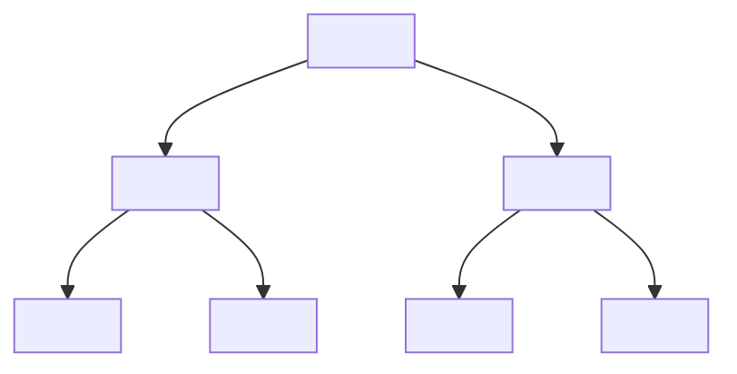

## **제약·바이오 기업 공시 모범사례 개선내용(1 ~ 2p)**

▣ 동 내용은 기존의 ‘제약·바이오 기업 사업보고서 기재 모범사례’를 개선한 사항이며, 모범사례가 제시하는 **작성양식, 기재범위 및 기재내용은 기업의 합리적 판단에 따라 조정할 수 있습니다.** 다만, 관련 내용은 투자자들을 위해 상세히 기재되어야 하며, 모범사례 이외에도 **추가로 기재하여야 할 사항이 있는지도 검토하여야 합니다.**

### **9. 경영상의 주요계약**

※ 계약의 종류별로 구분하여 고유의 특성 및 리스크 등을 반영한 정보를 기재
**<u>해당 계약이 없는 경우 “해당사항 없음”으로 기재</u>**

#### **가. 라이선스아웃(License-out) 계약**

##### **(1) 품 목: ○○○**

<table><tr><td><strong>① 투자유의사항</strong></td><td>기술이전 계약은 계약금, 개발 마일스톤, 허가·판매 마일스톤 및 로열티로 구성되어 있습니다. 이 중 계약금을 제외한 마일스톤 및 로열티는 임상 시험 성공, 품목허가 획득, 매출 달성 등 일정 조건 충족시에만 수취 가능한 금액으로 계약체결 시점에 수취가 <u>확정된 금액이 아닙니다.</u>  <u>일반적으로 허가·판매 마일스톤 > 개발 마일스톤 > 계약금 순으로 지급규모가 설정되는 경우가 많으니 투자시 유의하시기 바랍니다..</u></td></tr>
<tr><td><strong>② 계약상대방</strong></td><td><u>□□□(프랑스)</u> (<strong>※ 계약상대 회사명 및 소재국가를 기재</strong>)  <u>계약상의 기밀유지를 이유로 계약상대방을 비공개하는 경우라 하더라도, 계약</u><u>상대방에 대한 아래 정보는 충실히 기재하시기 바랍니다.</u>  1. <u>임직원 수</u>: 500명 2. <u>주요 사업</u>: 항암제 개발 및 판매 3. <u>임상 3상 이상 개발 경험</u>: 2건 4. <u>최근 사업연도 매출액</u>: 10억~100억$\n* 1억$미만, 1억~10억$, 10억~100억$, 100억$ 이상 중 해당 구간을 기재 5. <u>블록버스터 의약품*</u> <u>보유 여부</u>: 보유 * 연간 매출 10억$ 이상 의약품</td></tr>
<tr><td><strong>③ 계약내용</strong></td><td><u>□□□은 ○○○에 대한 독점적</u> <u>권리를 갖고 임상시험, 허가, 생산, 상업화 등을 진행</u></td></tr>
<tr><td><strong>④ 대상지역</strong></td><td>전세계(한국 제외) (<strong>※ 판권 판매지역을 기재</strong>)</td></tr>
<tr><td><strong>⑤ 계약기간</strong></td><td>계약체결일: 0000.00.00 (계약변경일: 0000.00.00) 계약종료일: 제품 출시후 00년</td></tr></table>

- 1 -

<table><tr><td>⑥ 총 계약금액</td><td>000백만원(EUR 000), 로열티는 별도</td></tr>
<tr><td>⑦ 수취금액</td><td>&#x3C;반환의무 없는 금액> 계약금 (Upfront Payment) : 00백만원(EUR 00), 0000년 00월 수취 마일스톤(Milestone) : 000백만원(EUR 000), 0000년 00월 수취  &#x3C;반환의무 발생가능 금액> 해당사항 없음 [또는 000백만원(EUR 000), 0000년 00월 수취]</td></tr>
<tr><td>⑧ 계약조건</td><td>계약금 (Upfront Payment) : 00백만원(EUR 00) - 수취조건: 계약 체결시  마일스톤(Milestone) : 000백만원(EUR 000) - 수취조건: 각 임상단계 성공, 판매 승인, 적응증 추가 등  로열티(Royalty) : 매출액의 0%/0년, 0%/0년 - 수취조건: 매출 발생시  임상, 등록, 상업화 실패시 계약은 종료될 수 있으며, 계약 종료시에도 회사의 위약금 지급의무는 없음</td></tr>
<tr><td>⑨ 회계처리방법</td><td>계약금 수취액 00백만원(EUR 000)은 00개월 동안 분할하여 수익 인식 마일스톤 수취액 000백만원(EUR 000)은 00개월 동안 분할하여 수익 인식  ※ 계약금, 마일스톤 등 수취금액에 대한 회사의 수익인식 회계처리 방법을 기재</td></tr>
<tr><td>⑩ 대상기술</td><td>※ 라이선스아웃 계약을 체결한 품목과 관련된 기술의 주요내용을 기재</td></tr>
<tr><td>⑪ 개발 진행경과</td><td>&#x3C;거래상대방> ※ 계약체결 시점부터 공시서류 작성기준일까지의 거래상대방의 각 지역별 및 임상 단계별 승인일, 임상 시작일, 임상 중단일 등을 기재  &#x3C;회사> ※ 계약체결 시점부터 공시서류 작성기준일까지의 회사의 한국 등에서의 각 임상 단계별 승인일, 임상 시작일, 임상 중단일 등을 기재</td></tr>
<tr><td>⑫ 기타사항</td><td>※ 기타 추가 기재할 내용이 있는 경우 자유롭게 기재</td></tr></table>

- 2 -

## 라. 연구개발실적

### **(1) 연구개발 이력관리 총괄표(신설)**

공시서류 작성기준일 현재\* 당사가 보유한 전 파이프라인 현황은 다음과 같습니다.
* 작성기준일로부터 <u>3년 내</u> 개발이력이 있는 파이프라인

#### **[연구개발 이력관리 총괄표] (예시)**

<table>
    <tr>
      <td>파이프라인
ID</td>
      <td>품목</td>
      <td>적응증</td>
      <td>최초
공시시점</td>
      <td>현재 상태1)</td>
      <td>개발 단계2)</td>
    </tr>
    <tr>
      <td colspan="6"></td>
    </tr>
    <tr>
      <td>P-001</td>
      <td>ABL-101</td>
      <td>비소세포폐암</td>
      <td>‘21.3월</td>
      <td>개발 중</td>
      <td>임상
3상</td>
    </tr>
    <tr>
      <td>P-002</td>
      <td>ABL-102</td>
      <td>유방암</td>
      <td>‘20.6월</td>
      <td>개발중단</td>
      <td>임상
2상
종료</td>
    </tr>
    <tr>
      <td>P-003</td>
      <td>ABL-103</td>
      <td>고형암</td>
      <td>‘21.9월</td>
      <td>기술이전</td>
      <td>기술이전
후 공동개발</td>
    </tr>
    <tr>
      <td>P-004</td>
      <td>ABL-104</td>
      <td>희귀질환 A</td>
      <td>‘22.1월</td>
      <td>허가심사
진행 중</td>
      <td>품목허가
심사</td>
    </tr>
    <tr>
      <td>P-005</td>
      <td>ABL-105</td>
      <td>황반변성</td>
      <td>‘18.9월</td>
      <td>판매중</td>
      <td>상업화</td>
    </tr>
</table>

1) 개발 중, 허가심사 중, 판매 중, 개발 중단, 판매 중단, 기술이전, 기술반환 등
2) 후보물질 발굴, 전임상, IND승인, 임상1,2,3상, 품목허가 신청, 품목허가 심사, 품목허가 획득 등

#### ※ 파이프라인 ID 관리 방법

1) 파이프라인별로 고유 식별번호를 부여하도록 하고, 기 부여된 고유 식별번호는 삭제나 임의 변경이 불가능하며, 재사용이 금지된다.
2) 동일 품목의 단순한 적응증 확장이나 추가 임상은 동일 파이프라인 ID로 관리하되, 전혀 <u>다른 질환으로 개발</u>되는 경우는 <u>별도 파이프라인 ID를</u> 부여하여 구분관리하도록 한다.

- 3 -

## (2) 연구개발 진행 현황 및 향후계획

### (가) 품 목: ○○○

<table><tr><td><strong>①구 분</strong></td><td>바이오 신약</td></tr>
<tr><td><strong>②적응증</strong></td><td>※ 해당 의약품에 의해 치료 효과가 기대되는 병이나 증상 등을 기재</td></tr>
<tr><td><strong>③작용기전</strong></td><td>※ 약물이 체내에서 효능을 발휘하는 생화학 반응 과정 등을 간략히 설명</td></tr>
<tr><td><strong>④제품의 특성</strong></td><td>※ 적응증, 작용기전 외의 기타 특성을 기재(예: 기존 제품과의 차이점, 기반 기술 등)</td></tr>
<tr><td><strong>⑤진행경과</strong></td><td>※ 그간의 임상진행 경과 등을 기재(단계별 임상시험 승인일 및 임상 시작일, 진행 국가, 임상시험 신청 상태인 경우 신청일, 정부의 보완요구 또는 반려 사실 등) [라이센스아웃(기술이전) 또는 라이센스인(기술도입) 등의 계약이 체결된 경우, 회사뿐만 아니라 상대회사의 임상진행 경과 등을 함께 기재(상대회사명, 국가 등 포함)]  <strong>(추가)</strong> 직전 공시한 <strong>⑥향후계획</strong>* 대비 <u>1년 이상 지연된</u> 경우, 동 <u>사실과 주요 원인을</u> 함께 기재</td></tr>
<tr><td><strong>⑥향후계획</strong></td><td>※ 상위 임상단계 신청일정, 향후 연구개발 계획, 제품화 계획 등을 구체적으로 기재</td></tr>
<tr><td><strong>⑦시장규모 및 경쟁제품</strong></td><td><strong>(통합)</strong> 경쟁제품 및 시장규모 란 통합  <strong>(추가)</strong> <u>실제 목표시장</u>* 중심으로 시장규모를 산정하고, 회사의 사업 역량을 판단할 수 있는 근거를 기재  * 전체시장 중 사업전략, 생산능력 등을 고려하여 실제 공략하려는 시장  - (예시1) 경쟁 약물 현황(적응증 및 작용기전이 유사한 경쟁제품의 개발회사 및 현재 진행 단계), 기존 치료제와의 차별성, 회사의 영업력 및 영업망 등을 구체적으로 기재  - (예시2) 후발주자로 시장에 진입하는 경우 기존 시장에서 경쟁력을 가질 수 있는 전략과 강점을 기재  ※ [타사에서 유사한 제품의 개발이 이루어지고 있지 않은 경우, 연구개발 초기 단계로 (신약후보물질 전임상 등) 경쟁제품을 특정하기 어려운 경우 등에는 이러한 사실을 기재]</td></tr>
<tr><td><strong>⑧관련논문 등</strong></td><td>※ 해당 의약품과 관련된 논문(학술지명 포함), 학회발표(학회명 포함) 사례 등을 기재 [논문게재, 학회발표 등이 이루어지지 않은 경우에는 이러한 사실을 기재]</td></tr>
<tr><td><strong>⑨기타사항</strong></td><td>※ 기타 추가 기재할 내용이 있는 경우 자유롭게 기재(예: 정부보조금, 공동개발 등)</td></tr></table>

- 4 -

## **개선내용을 반영한 공시 모범사례 전문(全文)**

※ '21.1월 배포된 모범사례를 일부 개선

### **동 모범사례의 성격**

* 동 사업보고서 기재 모범사례는 **제약·바이오** 기업의 사업보고서 작성 편의를 도모하고 정보이용자의 이해가능성을 제고하고자 참고목적으로 제시하는 것입니다.

* 동 모범사례는 **기업공시서식 작성기준 제4-2-10조(경영상의 주요계약 등)** 및 **제4-2-11조(연구개발활동)**에서 정하고 있는 공시사항 중 **제약·바이오** 기업이 특히 충실히 기재할 필요가 있는 사항 위주로 마련하였습니다.

* 동 모범사례는 공시 참고를 위해 마련된 것으로 모범사례가 제시하는 양식, 기재범위 및 기재내용은 **기업의 합리적 판단에 따라 조정될 수 있습니다.** 또한 투자자에게 필요한 **모든 정보를 포함하고 있는 것은 아니므로,** 기업은 모범사례에서 제시된 사항 이외에 투자자를 위해 추가로 기재하여야 할 사항이 있는지 검토하여야 합니다.

### **9. 경영상의 주요계약**

※ 계약의 종류별로 구분하여 고유의 특성 및 리스크 등을 반영한 정보를 기재
**<u>해당 계약이 없는 경우 “해당사항 없음”으로 기재</u>**

#### **가. 라이선스아웃(License-out) 계약**

공시서류 작성기준일 현재 당사가 체결 중인 라이선스아웃(License-out) 계약의 현황은 다음과 같습니다.

#### **< 라이선스아웃 계약 총괄표 >**

(단위: 백만원)

<table><tr><th>품 목</th><th>계약상대방</th><th>대상지역</th><th>계약체결일</th><th>계약종료일</th><th>총 계약금액*</th><th>수취금액*</th><th>진행단계</th></tr>
<tr><td>○○○</td><td>□□□</td><td>전세계 (한국 제외)</td><td>0000.00.00</td><td>제품 출시후 00년</td><td>000</td><td>00</td><td>임상2상</td></tr>
<tr><td>○○○</td><td>□□□</td><td>미국</td><td>0000.00.00</td><td>0000.00.00</td><td>000</td><td>00</td><td>임상1상</td></tr>
<tr><td>○○○</td><td>□□□</td><td>중국</td><td>0000.00.00</td><td>종료기간 없음</td><td>000</td><td>00</td><td>임상3상</td></tr>
<tr><td colspan="5">합 계</td><td>0,000</td><td>000</td><td></td></tr></table>

* 외화금액은 공시서류 작성기준일 현재 환율로 환산

- 5 -

※ 상기 ‘라이센스아웃 계약 총괄표’에 기재된 각각의 계약별로 상세내용을 기재

(1) 품 목 : ○○○

<table><tr><td>① 투자유의사항</td><td>기술이전 계약은 계약금, 개발 마일스톤, 허가판매 마일스톤 및 로열티로 구성되어 있습니다. 이 중 계약금을 제외한 마일스톤 및 로열티는 임상 시험 성공, 품목허가 획득, 매출 달성 등 일정 조건 충족시에만 수취 가능한 금액으로 계약체결 시점에 수취가 확정된 금액이 아닙니다. 일반적으로 허가·판매 마일스톤 > 개발 마일스톤 > 계약금 순으로 지급규모가 설정되는 경우가 많으니 투자시 유의하시기 바랍니다.</td></tr>
<tr><td>② 계약상대방</td><td>□□□(프랑스) (※ 계약상대 회사명 및 소재국가를 기재)  계약상의 기밀유지를 이유로 계약상대방을 비공개하는 경우라 하더라도, 계약 상대방에 대한 아래 정보는 충실히 기재하시기 바랍니다.  1. <u>임직원 수</u> : 500명 2. <u>주요 사업</u>: 항암제 개발 및 판매 3. <u>임상 3상 이상 개발 경험</u>: 2건 4. <u>최근 사업연도 매출액</u>: 10억~100억$\n* 1억$미만, 1억~10억$, 10억~100억$, 100억$ 이상 중 해당 구간을 기재 5. <u>블록버스터 의약품</u>* 보유 여부: 보유 * 연간 매출 10억$ 이상 의약품</td></tr>
<tr><td>③ 계약내용</td><td>□□□은 ○○○에 대한 독점적 권리를 갖고 임상시험, 허가, 생산, 상업화 등을 진행</td></tr>
<tr><td>④ 대상지역</td><td>전세계(한국 제외) (※ 판권 판매지역을 기재)</td></tr>
<tr><td>⑤ 계약기간</td><td>계약체결일 : 0000.00.00 (계약변경일 : 0000.00.00) 계약종료일: 제품 출시후 00년</td></tr>
<tr><td>⑥ 총 계약금액</td><td>000백만원(EUR 000), 로열티는 별도</td></tr>
<tr><td>⑦ 수취금액</td><td>&#x3C;반환의무 없는 금액> 계약금 (Upfront Payment) : 00백만원(EUR 000), 0000년 00월 수취 마일스톤(Milestone) : 000백만원(EUR 000), 0000년 00월 수취 &#x3C;반환의무 발생가능 금액> 해당사항 없음 [또는 000백만원(EUR 000), 0000년 00월 수취]</td></tr>
<tr><td>⑧ 계약조건</td><td>계약금 (Upfront Payment) : 00백만원(EUR 00) - 수취조건: 계약 체결시 마일스톤(Milestone) : 000백만원(EUR 000) - 수취조건: 각 임상단계 성공, 판매 승인, 적용증 추가 등 로열티(Royalty) : 매출액의 0%/0년, 0%/0년 - 수취조건: 매출 발생시 임상, 등록, 상업화 실패시 계약은 종료될 수 있으며, 계약 종료시에도 회사의 위약금 지급의무는 없음</td></tr>
<tr><td>⑨ 회계처리방법</td><td>계약금 수취액 00백만원(EUR 000)은 00개월 동안 분할하여 수익 인식 마일스톤 수취액 000백만원(EUR 000)은 00개월 동안 분할하여 수익 인식  ※ 계약금, 마일스톤 등 수취금액에 대한 회사의 수익인식 회계처리 방법을 기재</td></tr>
<tr><td>⑩ 대상기술</td><td>※ 라이센스아웃 계약을 체결한 품목과 관련된 기술의 주요내용을 기재</td></tr>
<tr><td>⑪ 개발 진행경과</td><td>&#x3C;거래상대방> ※ 계약체결 시점부터 공시서류 작성기준일까지의 거래상대방의 각 지역별 및 임상 단계별 승인일, 임상 시작일, 임상 중단일 등을 기재  &#x3C;회사> ※ 계약체결 시점부터 공시서류 작성기준일까지의 회사의 한국 등에서의 각 임상 단계별 승인일, 임상 시작일, 임상 중단일 등을 기재</td></tr>
<tr><td>⑫ 기타사항</td><td>※ 기타 추가 기재할 내용이 있는 경우 자유롭게 기재</td></tr></table>

- 6 -

(2) 품 목 : ○○○

...

## 나. 라이센스인(License-in) 계약

공시서류 작성기준일 현재 당사가 체결 중인 라이센스인(License-in) 계약의 현황은 다음과 같습니다.

### **< 라이센스인 계약 총괄표 >**

(단위: 백만원)

<table>
  <thead>
    <tr>
      <th>품 목</th>
      <th>계약상대방</th>
      <th>대상지역</th>
      <th>계약체결일</th>
      <th>계약종료일</th>
      <th>총 계약금액*</th>
      <th>지급금액*</th>
      <th>진행단계</th>
    </tr>
  </thead>
  <tbody>
    <tr>
      <td>○○○</td>
      <td>□□□</td>
      <td>한국</td>
      <td>0000.00.00</td>
      <td>제품 출시후 00
년</td>
      <td>000</td>
      <td>00</td>
      <td>임상
2상</td>
    </tr>
    <tr>
      <td>○○○</td>
      <td>□□□</td>
      <td>전세계</td>
      <td>0000.00.00</td>
      <td>0000.00.00</td>
      <td>000</td>
      <td>00</td>
      <td>임상
1상</td>
    </tr>
    <tr>
      <td colspan="5">합 계</td>
      <td>0,000</td>
      <td>000</td>
      <td></td>
    </tr>
  </tbody>
</table>

* 외화금액은 공시서류 작성기준일 현재 환율로 환산

※ 상기 ‘라이센스인 계약 총괄표’에 기재된 각각의 계약별로 상세내용을 기재

(1) 품 목 : ○○○

<table>
  <thead>
    <tr>
      <th>품 목</th>
      <th>계약상대방</th>
      <th>대상지역</th>
      <th>계약체결일</th>
      <th>계약종료일</th>
      <th>총 계약금액*</th>
      <th>지급금액*</th>
      <th>진행단계</th>
    </tr>
  </thead>
  <tbody>
    <tr>
      <td>○○○</td>
      <td>□□□</td>
      <td>한국</td>
      <td>0000.00.00</td>
      <td>제품 출시후 00
년</td>
      <td>000</td>
      <td>00</td>
      <td>임상
2상</td>
    </tr>
    <tr>
      <td>○○○</td>
      <td>□□□</td>
      <td>전세계</td>
      <td>0000.00.00</td>
      <td>0000.00.00</td>
      <td>000</td>
      <td>00</td>
      <td>임상
1상</td>
    </tr>
    <tr>
      <td colspan="5">합 계</td>
      <td>0,000</td>
      <td>000</td>
      <td></td>
    </tr>
  </tbody>
</table>

- 7 -

<table><tr><td>⑧ 회계처리방법</td><td>※ 계약금, 마일스톤 등 지급금액에 대한 회사의 비용인식 회계처리 방법을 기재 (예: 00개월 동안 분할하여 비용인식, 일시에 비용인식, 임상0상 이후의 마일스톤 지급액은 무형자산으로 계상 등)</td></tr>
<tr><td>⑨ 대상기술</td><td>※ 라이선스인 계약을 체결한 품목과 관련된 기술의 주요내용을 기재</td></tr>
<tr><td>⑩ 개발 진행경과</td><td>&#x3C;거래상대방> ※ 계약체결 시점부터 공시서류 작성기준일까지의 거래상대방의 각 지역별 및 임상 단계별 승인일, 임상 시작일, 임상 중단일 등을 기재  &#x3C;회사> ※ 계약체결 시점부터 공시서류 작성기준일까지의 회사의 한국 등에서의 각 임상 단계별 승인일, 임상 시작일, 임상 중단일 등을 기재</td></tr>
<tr><td>⑪ 기타사항</td><td>※ 기타 추가 기재할 내용이 있는 경우 자유롭게 기재</td></tr></table>

(2) 품 목: ○○○

...

## 다. 기술제휴계약

※ 중요 계약의 경우 총괄표상 상세내용 등을 구체적으로 기재, 이하 항목 동일

### < 기술제휴계약 총괄표 >

(단위: 백만원)

<table>
  <thead>
    <tr>
      <th>품 목</th>
      <th>계약상대방</th>
      <th>계약목적조건‧ 등
상세내용</th>
      <th>계약체결일</th>
      <th>계약종료일</th>
      <th>계약금액</th>
      <th>수수 지급
( )
방법</th>
      <th>진행경과 등
비고</th>
    </tr>
  </thead>
  <tbody>
    <tr>
      <td>○○○</td>
      <td>□□□</td>
      <td></td>
      <td>0000.00.00</td>
      <td>0000.00.00</td>
      <td>000</td>
      <td></td>
      <td></td>
    </tr>
    <tr>
      <td>○○○</td>
      <td>□□□</td>
      <td></td>
      <td>0000.00.00</td>
      <td>0000.00.00</td>
      <td>000</td>
      <td></td>
      <td></td>
    </tr>
  </tbody>
</table>

## 라. 판매계약

### < 판매계약 총괄표 >

(단위: 백만원)

<table>
  <thead>
    <tr>
      <th>품 목</th>
      <th>계약상대방</th>
      <th>계약목적조건‧ 등
상세내용</th>
      <th>계약체결일</th>
      <th>계약종료일</th>
      <th>계약금액</th>
      <th>수수 지급
( )
방법</th>
      <th>진행경과 등
비고</th>
    </tr>
  </thead>
  <tbody>
    <tr>
      <td>○○○</td>
      <td>□□□</td>
      <td></td>
      <td>0000.00.00</td>
      <td>0000.00.00</td>
      <td>000</td>
      <td></td>
      <td></td>
    </tr>
    <tr>
      <td>○○○</td>
      <td>□□□</td>
      <td></td>
      <td>0000.00.00</td>
      <td>0000.00.00</td>
      <td>000</td>
      <td></td>
      <td></td>
    </tr>
  </tbody>
</table>

## 마. 기타 ○○계약

### < 기타 ○○계약 총괄표 >

(단위: 백만원)

<table>
  <thead>
    <tr>
      <th>품 목</th>
      <th>계약상대방</th>
      <th>계약목적조건‧ 등
상세내용</th>
      <th>계약체결일</th>
      <th>계약종료일</th>
      <th>계약금액</th>
      <th>수수 지급
( )
방법</th>
      <th>진행경과 등
비고</th>
    </tr>
  </thead>
  <tbody>
    <tr>
      <td>○○○</td>
      <td>□□□</td>
      <td></td>
      <td>0000.00.00</td>
      <td>0000.00.00</td>
      <td>000</td>
      <td></td>
      <td></td>
    </tr>
    <tr>
      <td>○○○</td>
      <td>□□□</td>
      <td></td>
      <td>0000.00.00</td>
      <td>0000.00.00</td>
      <td>000</td>
      <td></td>
      <td></td>
    </tr>
  </tbody>
</table>

– 8 –

## 10. 연구개발활동

### 가. 연구개발활동의 개요

당사는 …

※ 회사의 연구개발활동에 대한 간략한 설명을 기재

### 나. 연구개발 담당조직

#### (1) 연구개발 조직 개요

당사의 연구개발 조직은 □□연구소(▽▽소재) 산하 0개팀, □□연구소(▽▽소재) 산하 0개팀 등 총 0개 연구소, 0개 팀으로 구성되어 있으며, 그 현황은 다음과 같습니다.

□□연구소는 …

※ 회사 연구개발 조직의 구성, 각 조직별 업무내용 등에 대한 설명을 기재

#### **< 연구개발 조직 구성 >**

<table><tr><th>연구소</th><th>팀</th><th>주요 업무</th></tr>
<tr><td rowspan="2">□□연구소</td><td>△△팀</td><td>연구소 총괄 및 연구과제 기획</td></tr>
<tr><td>△△팀</td><td>○○○ 관련 연구</td></tr>
<tr><td rowspan="2">□□연구소</td><td>△△팀</td><td>○○○ 관련 연구</td></tr>
<tr><td>△△팀</td><td>○○○ 관련 연구</td></tr></table>

#### **< 조직도 >**

flow_chart: organizational chart

- 9 -

## (2) 연구개발 인력 현황

공시서류 작성기준일 현재 당사는 박사급 00명, 석사급 00명 등 총 00명의 연구 인력을 보유하고 있으며, 그 현황은 다음과 같습니다.

당사의 인력은 ...

※ 회사 연구개발 인력의 구성, 특징 등에 대한 설명을 기재

### &#x3C; 연구개발 인력 현황 > (단위: 명)

<table><tr><th rowspan="2" colspan="2">구 분</th><th colspan="4">인 원</th></tr>
<tr><th>박 사</th><th>석 사</th><th>기 타</th><th>합 계</th></tr>
<tr><td rowspan="2">□□연구소</td><td>△△팀</td><td>1</td><td>1</td><td>1</td><td>3</td></tr>
<tr><td>△△팀</td><td>1</td><td>1</td><td>1</td><td>3</td></tr>
<tr><td rowspan="2">□□연구소</td><td>△△팀</td><td>1</td><td>1</td><td>1</td><td>3</td></tr>
<tr><td>△△팀</td><td>1</td><td>1</td><td>1</td><td>3</td></tr>
<tr><td colspan="2">합 계</td><td>4</td><td>4</td><td>4</td><td>12</td></tr></table>

## (3) 핵심 연구인력

당사의 핵심 연구인력은 연구소장인 ◇◇◇, 부연구소장인 ◇◇◇, ○○○ 개발과 관련하여 프로젝트 매니저 역할을 수행하고 있는 ◇◇◇ 등입니다.

연구소장인 ◇◇◇은 ...

※ 핵심 연구인력들의 주요경력, 연구실적 등 연구개발 능력 수준을 판단할 수 있는 내용을 기재

### &#x3C; 핵심 연구인력 현황 >

<table><tr><th colspan="2">TABLE_PLACEHOLDER_TOP_LEFT_0</th></tr></table>

* 논문, 연구보고서, 학술지 발표, 학술대회 주제 발표 등의 내역을 기재

<table>
  <thead>
    <tr>
      <th>직 위</th>
      <th>성 명</th>
      <th>담당업무</th>
      <th>주요 경력</th>
      <th>주요 연구실적*</th>
    </tr>
  </thead>
  <tbody>
    <tr>
      <td>연구소장
(
전무)</td>
      <td>◇◇◇</td>
      <td>연구총괄</td>
      <td>◎◎
대학교 ◎◎학 박사(‘00)
◎◎
대학교 ◎◎학과 교수(‘00~’00)</td>
      <td>[
논문]
▽▽▽▽
(‘00
년
, ▽▽학술지)
[
학회발표]
▽▽▽▽
(‘00
년
, ▽▽학회)</td>
    </tr>
    <tr>
      <td>부연구소장
(
상무)</td>
      <td>◇◇◇</td>
      <td>임상시험
총괄</td>
      <td>◎◎
대학교 ◎◎학 박사(‘00)
◎◎
연구소 ◎◎연구원(‘00~’00)
◎◎
제약 ◎◎팀 이사(‘00~’00)</td>
      <td>[
논문]
▽▽▽▽
(‘00
년
, ▽▽학술지)
[
학회발표]
▽▽▽▽
(‘00
년
, ▽▽학회)</td>
    </tr>
    <tr>
      <td>이사</td>
      <td>◇◇◇</td>
      <td>프로젝트
매니저</td>
      <td>◎◎
대학교 ◎◎학 석사(‘00)
◎◎
연구소 ◎◎연구원(‘00~’00)</td>
      <td>[
논문]
▽▽▽▽
(‘00
년
, ▽▽학술지)</td>
    </tr>
  </tbody>
</table>

- 10 -

## 다. 연구개발비용

**<u>※ 연결기업인 경우 연결 및 별도 재무제표를 기준으로 모두 기재</u>**

당사의 최근 3년간 연구개발비용은 다음과 같습니다.

당사는 일반적으로 신약 개발 프로젝트가 ●●●단계를 통과한 이후 발생한 지출을 무형자산으로 인식하고, 이전 단계에서 발생한 지출은当期비용으로 회계처리하고 있습니다.

**[기재례 ①]** 정부보조금을 연구개발비 회계처리금액에 가산하는 방식으로 작성

#### **< 연구개발비용 현황 (연결재무제표 기준) >**

(단위: 천원, %)

<table><tr><th colspan="2">구 분</th><th>제00기</th><th>제00기</th><th>제00기</th><th>비 고</th></tr>
<tr><td rowspan="6">비용의 성격별 분류1)</td><td>원재료비</td><td>000</td><td>000</td><td>000</td><td></td></tr>
<tr><td>인건비</td><td>000</td><td>000</td><td>000</td><td></td></tr>
<tr><td>감가상각비</td><td>000</td><td>000</td><td>000</td><td></td></tr>
<tr><td>위탁용역비</td><td>000</td><td>000</td><td>000</td><td></td></tr>
<tr><td>기타</td><td>000</td><td>000</td><td>000</td><td></td></tr>
<tr><td>연구개발비용 합계</td><td>0,000</td><td>0,000</td><td>0,000</td><td></td></tr>
<tr><td rowspan="6">회계처리 내역</td><td>판매비와 관리비</td><td>000</td><td>000</td><td>000</td><td></td></tr>
<tr><td>제조경비</td><td>000</td><td>000</td><td>000</td><td></td></tr>
<tr><td>개발비(무형자산)</td><td>000</td><td>000</td><td>000</td><td></td></tr>
<tr><td>회계처리금액 계</td><td>0,000</td><td>0,000</td><td>0,000</td><td></td></tr>
<tr><td>정부보조금2)</td><td>00</td><td>00</td><td>00</td><td></td></tr>
<tr><td>연구개발비용 합계3)</td><td>0,000</td><td>0,000</td><td>0,000</td><td></td></tr>
<tr><td colspan="2">연구개발비 / 매출액 비율 [연구개발비용 합계 ÷当期매출액×100]</td><td>0.00</td><td>0.00</td><td>0.00</td><td></td></tr></table>

1) 연구개발 중인 신약의 종류가 적어 비용의 성격별 분류금액을 공시할 경우 해당 신약의 원가노출 등 영업에 현저한 손실을 초래할 수 있다고 판단되는 경우에는 이러한 사실을 적시하고 그 내용을 간략하게 기재할 수 있음

2) 비용 또는 자산에서 차감하는 방식으로 회계처리 한 정부보조금(국고보조금) 금액 (별도의 수익으로 인식한 보조금 금액은 제외)

3) ‘회계처리금액 계’ + ‘정부보조금’ (→ ‘비용의 성격별 분류’란의 ‘연구개발비용 합계’와 동일금액)

- 11 -

## **< 연구개발비용 현황 (별도재무제표 기준) >**

(단위: 천원, %)

<table><tr><th colspan="2">구 분</th><th>제00기</th><th>제00기</th><th>제00기</th><th>비 고</th></tr>
<tr><td rowspan="6">비용의 성격별 분류</td><td>원재료비</td><td>000</td><td>000</td><td>000</td><td></td></tr>
<tr><td>인건비</td><td>000</td><td>000</td><td>000</td><td></td></tr>
<tr><td>감가상각비</td><td>000</td><td>000</td><td>000</td><td></td></tr>
<tr><td>위탁용역비</td><td>000</td><td>000</td><td>000</td><td></td></tr>
<tr><td>기타</td><td>000</td><td>000</td><td>000</td><td></td></tr>
<tr><td>연구개발비용 합계</td><td>0,000</td><td>0,000</td><td>0,000</td><td></td></tr>
<tr><td rowspan="6">회계처리 내역</td><td>판매비와 관리비</td><td>000</td><td>000</td><td>000</td><td></td></tr>
<tr><td>제조경비</td><td>000</td><td>000</td><td>000</td><td></td></tr>
<tr><td>개발비(무형자산)</td><td>000</td><td>000</td><td>000</td><td></td></tr>
<tr><td>회계처리금액 계</td><td>0,000</td><td>0,000</td><td>0,000</td><td></td></tr>
<tr><td>정부보조금</td><td>00</td><td>00</td><td>00</td><td></td></tr>
<tr><td>연구개발비용 합계</td><td>0,000</td><td>0,000</td><td>0,000</td><td></td></tr>
<tr><td colspan="2">연구개발비 / 매출액 비율 [연구개발비용 합계÷당기매출액×100]</td><td>0.00</td><td>0.00</td><td>0.00</td><td></td></tr></table>

**[기재례 ②]** 정부보조금을 연구개발비용 지출총액 합계에서 차감하는 방식으로 작성

## **< 연구개발비용 현황 (연결/별도 재무제표 기준) >**

(단위: 천원, %)

<table><tr><th colspan="2">구 분</th><th>제00기</th><th>제00기</th><th>제00기</th><th>비 고</th></tr>
<tr><td rowspan="8">비용의 성격별 분류</td><td>원재료비</td><td>000</td><td>000</td><td>000</td><td></td></tr>
<tr><td>인건비</td><td>000</td><td>000</td><td>000</td><td></td></tr>
<tr><td>감가상각비</td><td>000</td><td>000</td><td>000</td><td></td></tr>
<tr><td>위탁용역비</td><td>000</td><td>000</td><td>000</td><td></td></tr>
<tr><td>기타</td><td>000</td><td>000</td><td>000</td><td></td></tr>
<tr><td>연구개발비용 합계</td><td>0,000</td><td>0,000</td><td>0,000</td><td></td></tr>
<tr><td>(정부보조금)</td><td>(-) 000</td><td>(-) 000</td><td>(-) 000</td><td></td></tr>
<tr><td>보조금 차감 후 금액</td><td>0,000</td><td>0,000</td><td>0,000</td><td></td></tr>
<tr><td rowspan="4">회계처리 내역</td><td>판매비와 관리비</td><td>000</td><td>000</td><td>000</td><td></td></tr>
<tr><td>제조경비</td><td>000</td><td>000</td><td>000</td><td></td></tr>
<tr><td>개발비(무형자산)</td><td>000</td><td>000</td><td>000</td><td></td></tr>
<tr><td>회계처리금액 계</td><td>0,000</td><td>0,000</td><td>0,000</td><td></td></tr>
<tr><td colspan="2">연구개발비 / 매출액 비율 [연구개발비용 합계÷당기매출액×100]</td><td>0.00</td><td>0.00</td><td>0.00</td><td></td></tr></table>

- 12 -

## 라. 연구개발실적

### **(1) 연구개발 이력관리 총괄표(신설)**

공시서류 작성기준일 현재\* 당사가 보유한 전 파이프라인 현황은 다음과 같습니다.
* 작성기준일로부터 <u>3년</u> 내 개발이력이 있는 파이프라인

#### **[연구개발 이력관리 총괄표] (예시)**

<table>
    <tr>
      <td>파이프라인
ID</td>
      <td>품목</td>
      <td>적응증</td>
      <td>최초
공시시점</td>
      <td>현재 상태1)</td>
      <td>개발 단계2)</td>
    </tr>
    <tr>
      <td colspan="6"></td>
    </tr>
    <tr>
      <td>P-001</td>
      <td>ABL-101</td>
      <td>비소세포폐암</td>
      <td>‘21.3월</td>
      <td>개발 중</td>
      <td>임상
3상</td>
    </tr>
    <tr>
      <td>P-002</td>
      <td>ABL-102</td>
      <td>유방암</td>
      <td>‘20.6월</td>
      <td>개발중단</td>
      <td>임상
2상
종료</td>
    </tr>
    <tr>
      <td>P-003</td>
      <td>ABL-103</td>
      <td>고형암</td>
      <td>‘21.9월</td>
      <td>기술이전</td>
      <td>기술이전
후 공동개발</td>
    </tr>
    <tr>
      <td>P-004</td>
      <td>ABL-104</td>
      <td>희귀질환 A</td>
      <td>‘22.1월</td>
      <td>허가심사
진행 중</td>
      <td>품목허가
심사</td>
    </tr>
    <tr>
      <td>P-005</td>
      <td>ABL-105</td>
      <td>황반변성</td>
      <td>‘18.9월</td>
      <td>판매중</td>
      <td>상업화</td>
    </tr>
</table>

1) 개발 중, 허가심사 중, 판매 중, 개발 중단, 판매 중단, 기술이전, 기술반환 등
2) 후보물질 발굴, 전임상, IND승인, 임상1,2,3상, 품목허가 신청, 품목허가 심사, 품목허가 획득 등

#### ※ 파이프라인 ID 관리 방법

1) 파이프라인별로 고유 식별번호를 부여하도록 하고, 기 부여된 고유 식별번호는 삭제나 임의 변경이 불가능하며, 재사용이 금지된다.
2) 동일 품목의 단순한 적응증 확장이나 추가 임상은 동일 파이프라인 ID로 관리하되, 전혀 <u>다른 질환으로 개발</u>되는 경우는 <u>별도 파이프라인 ID</u>를 부여하여 구분관리하도록 한다.

– 13 –

## (2) 연구개발 진행 현황 및 향후계획

공시서류 작성기준일 현재 당사가 연구개발 진행 중인 신약[개량신약, 복제약(시밀러) 등 포함]의 현황은 다음과 같습니다.

#### **< 연구개발 진행 총괄표 >**

<table><tr><th rowspan="2" colspan="2">구 분</th><th rowspan="2">품 목</th><th rowspan="2">적응증</th><th rowspan="2">연구 시작일</th><th colspan="2">현재 진행단계</th><th rowspan="2">비 고</th></tr>
<tr><th>단계(국가)</th><th>승인일</th></tr>
<tr><td rowspan="4">바이오</td><td rowspan="2">신약</td><td>○○○</td><td>◇◇◇</td><td>0000년</td><td>임상 3상 (한국) 임상 2상 (EU)</td><td>0000년 0000년</td><td>라이센스아웃</td></tr>
<tr><td>○○○</td><td>◇◇◇</td><td>0000년</td><td>전임상</td><td>-</td><td></td></tr>
<tr><td rowspan="2">바이오시밀러</td><td>○○○</td><td>◇◇◇</td><td>0000년</td><td>임상 1상 (한국) 임상 1상 (미국)</td><td>0000년 0000년</td><td>공동개발</td></tr>
<tr><td>○○○</td><td>◇◇◇</td><td>0000년</td><td>임상 3상 (EU)</td><td>0000년</td><td></td></tr>
<tr><td rowspan="3">화학 합성</td><td rowspan="2">신약</td><td>○○○</td><td>◇◇◇</td><td>0000년</td><td>임상 2상 (한국) 임상 2상 (미국)</td><td>0000년</td><td>라이센스인*</td></tr>
<tr><td>○○○</td><td>◇◇◇</td><td>0000년</td><td>신약후보물질</td><td>-</td><td></td></tr>
<tr><td>개량신약</td><td>○○○</td><td>◇◇◇</td><td>0000년</td><td>임상 3상 (한국)</td><td>0000년</td><td>정부보조금</td></tr></table>

* 라이센스인 계약을 체결한 신약, (해외)종속회사에서 개발 중인 신약 등도 포함하여 기재

※ 상기 ‘연구개발 진행 총괄표’에 기재된 각각의 품목별로 상세내용을 기재

(가) 품 목 : ○○○

<table><tr><td><strong>①구 분</strong></td><td>바이오 신약</td></tr>
<tr><td><strong>②적응증</strong></td><td>※ 해당 의약품에 의해 치료 효과가 기대되는 병이나 증상 등을 기재</td></tr>
<tr><td><strong>③작용기전</strong></td><td>※ 약물이 체내에서 효능을 발휘하는 생화학 반응 과정을 간략히 설명</td></tr>
<tr><td><strong>④제품의 특성</strong></td><td>※ 적응증, 작용기전 외의 기타 특성을 기재(예: 기존 제품과의 차이점, 기반 기술 등)</td></tr>
<tr><td><strong>⑤진행경과</strong></td><td>※ 그간의 임상진행 경과 등을 기재(단계별 임상시험 승인일 및 임상 시작일, 진행 국가, 임상시험 신청 상태인 경우 신청일, 정부의 보완요구 또는 반려 사실 등) [라이센스아웃(기술이전) 또는 라이센스인(기술도입) 등의 계약이 체결된 경우, 회사뿐만 아니라 상대회사의 임상진행 경과 등을 함께 기재(상대회사명, 국가 등 포함)]  <strong>(추가)</strong> 직전 공시한 <strong>⑥향후계획*</strong> 대비 <u>1년 이상 지연된</u> 경우, 동 <u>사실과 주요 원인을 함께 기재</u></td></tr>
<tr><td><strong>⑥향후계획</strong></td><td>※ 상위 임상단계 신청일정, 향후 연구개발 계획, 제품화 계획 등을 구체적으로 기재</td></tr></table>

- 14 -

<table><tr><td rowspan="4"><strong>⑦ 시장규모 및 경쟁제품</strong></td><td><strong>(통합)</strong> 경쟁제품 및 시장규모 란 통합</td></tr>
<tr><td><strong>(추가)</strong> <u>실제 목표시장</u>* 중심으로 시장규모를 산정하고, 회사의 사업 역량을 판단할 수 있는 근거를 기재  * 전체시장 중 사업전략, 생산능력 등을 고려하여 실제 공략하려는 시장  - (예시1) 경쟁 약물 현황(적응증 및 작용기전이 유사한 경쟁제품의 개발회사 및 현재 진행 단계), 기존 치료제와의 차별성, 회사의 영업력 및 영업망 등을 구체적으로 기재  - (예시2) 후발주자로 시장에 진입하는 경우 기존 시장에서 경쟁력을 가질 수 있는 전략과 강점을 기재  ※ [타사에서 유사한 제품의 개발이 이루어지고 있지 않은 경우, 연구개발 초기 단계로 (신약후보물질 전임상 등) 경쟁제품을 특정하기 어려운 경우 등에는 이러한 사실을 기재]</td></tr>
<tr><td><strong>⑧ 관련논문 등</strong> ※ 해당 의약품과 관련된 논문(학술지명 포함), 학회발표(학회명 포함) 사례 등을 기재 [논문게재, 학회발표 등이 이루어지지 않은 경우에는 이러한 사실을 기재]</td></tr>
<tr><td><strong>⑨ 기타사항</strong> ※ 기타 추가 기재할 내용이 있는 경우 자유롭게 기재(예: 정부보조금, 공동개발 등)</td></tr></table>

(나) 품 목: ○○○
...

(다) 품 목: ○○○

<table><tr><td><strong>① 구 분</strong></td><td>바이오시밀러</td></tr>
<tr><td><strong>② 적응증</strong></td><td></td></tr>
<tr><td><strong>③ 작용기전</strong></td><td></td></tr>
<tr><td><strong>④ 제품의 특성</strong></td><td></td></tr>
<tr><td><strong>⑤ 진행경과</strong></td><td></td></tr>
<tr><td><strong>⑥ 향후계획</strong></td><td></td></tr>
<tr><td><strong>⑦ 시장규모 및 경쟁제품</strong></td><td></td></tr>
<tr><td><strong>⑧ 관련논문 등</strong></td><td></td></tr>
<tr><td><strong>⑨ 공동개발</strong></td><td>□□□와 ○○○ 공동연구계약(기술제휴계약, 기술협약 등)을 체결하고 공동개발</td></tr></table>

(라) 품 목: ○○○
...

(마) 품 목: ○○○
...

(바) 품 목: ○○○
...

- 15 -

## (사) 품 목 : ○○○

<table><tr><td>① 구 분</td><td>화학합성 개량신약</td></tr>
<tr><td>② 적응증</td><td></td></tr>
<tr><td>③ 작용기전</td><td></td></tr>
<tr><td>④ 제품의 특성</td><td></td></tr>
<tr><td>⑤ 진행경과</td><td></td></tr>
<tr><td>⑥ 향후계획</td><td></td></tr>
<tr><td>⑦ 시장규모 및 경쟁제품</td><td></td></tr>
<tr><td>⑧ 관련논문 등</td><td></td></tr>
<tr><td>⑨ 정부보조금</td><td>○○○ 개발과 관련하여 □□□의 △△△ 과제로 선정되어 000원을 지원받음</td></tr></table>

### (3) 연구개발 완료 실적

공시서류 작성기준일 현재 개발이 완료된 신약{개량신약, 복제약(시밀러) 등 포함}의 현황은 다음과 같습니다.

#### **<연구개발 완료 실적>**

<table><tr><th colspan="2">구 분</th><th>품 목</th><th>적응증</th><th>개발완료일*</th><th>현재 현황</th><th>비 고</th></tr>
<tr><td rowspan="4">바이오</td><td rowspan="2">신약</td><td>○○○</td><td>◇◇◇</td><td>0000년</td><td>한국, EU 판매중</td><td>□□에 라이선스아웃</td></tr>
<tr><td>○○○</td><td>◇◇◇</td><td>0000년</td><td>한국 판매중</td><td></td></tr>
<tr><td rowspan="2">바이오시밀러</td><td>○○○</td><td>◇◇◇</td><td>0000년</td><td>한국, 미국, EU 판매중</td><td>□□와 유통계약</td></tr>
<tr><td>○○○</td><td>◇◇◇</td><td>0000년</td><td>한국, 미국 판매중</td><td>□□와 유통계약</td></tr>
<tr><td rowspan="6">화학 합성</td><td rowspan="2">신약</td><td>○○○</td><td>◇◇◇</td><td>0000년</td><td>라이선스아웃 후 종료</td><td>□□에 라이선스아웃</td></tr>
<tr><td>○○○</td><td>◇◇◇</td><td>0000년</td><td>한국, EU 판매중</td><td>□□에 라이선스아웃</td></tr>
<tr><td rowspan="2">개량신약</td><td>○○○</td><td>◇◇◇</td><td>0000년</td><td>판매 중단(0000년)</td><td></td></tr>
<tr><td>○○○</td><td>◇◇◇</td><td>0000년</td><td>한국, 미국, EU 판매중</td><td>□□에 라이선스아웃</td></tr>
<tr><td rowspan="2">제네릭</td><td>○○○</td><td>◇◇◇</td><td>0000년</td><td>한국 판매중</td><td></td></tr>
<tr><td>○○○</td><td>◇◇◇</td><td>0000년</td><td>한국 판매중</td><td></td></tr></table>

\* 정부 판매승인일 등을 기재

※ 개별 설명이 필요한 품목이 있는 경우 자유롭게 추가 기재

- 16 -

## (4) 연구개발활동 및 판매 중단 현황

공시서류 작성기준일 현재 연구개발이 중단된 신약{개량신약, 복제약(시밀러) 등 포함} 및 판매가 중단된 품목의 현황은 다음과 같습니다.

※ <u>해당 연구개발 또는 품목이 없는 경우 “해당사항 없음”으로 기재</u>

### **< 연구개발활동 중단 현황 >**

<table>
  <thead>
    <tr>
      <th colspan="2" rowspan="2">구 분</th>
      <th rowspan="2">품 목</th>
      <th rowspan="2">적응증</th>
      <th rowspan="2">연구
시작일</th>
      <th colspan="2">최종 진행단계</th>
      <th rowspan="2">연구
중단일</th>
      <th rowspan="2">중단
사유</th>
      <th rowspan="2">재개
계획</th>
    </tr>
    <tr>
      <th>단계 국가
( )</th>
      <th>승인일</th>
    </tr>
  </thead>
  <tbody>
    <tr>
      <td rowspan="4">바이오</td>
      <td rowspan="2">신약</td>
      <td>○○○</td>
      <td>◇◇◇</td>
      <td>0000년</td>
      <td>임상 3상( 한국)
임상 2
상 (EU)</td>
      <td>0000년
0000년</td>
      <td>0000.0.00</td>
      <td></td>
      <td></td>
    </tr>
    <tr>
      <td>○○○</td>
      <td>◇◇◇</td>
      <td>0000년</td>
      <td>전임상</td>
      <td>-</td>
      <td>0000.0.00</td>
      <td></td>
      <td></td>
    </tr>
    <tr>
      <td rowspan="2">바이오시밀러</td>
      <td>○○○</td>
      <td>◇◇◇</td>
      <td>0000년</td>
      <td>임상 1상( 한국)
임상 1상( 미국)</td>
      <td>0000년
0000년</td>
      <td>0000.0.00</td>
      <td></td>
      <td></td>
    </tr>
    <tr>
      <td>○○○</td>
      <td>◇◇◇</td>
      <td>0000년</td>
      <td>임상 3 상 (EU)</td>
      <td>0000
년</td>
      <td>0000.0.00</td>
      <td></td>
      <td></td>
    </tr>
    <tr>
      <td rowspan="3">화학
합성</td>
      <td rowspan="2">신약</td>
      <td>○○○</td>
      <td>◇◇◇</td>
      <td>0000년</td>
      <td>임상 2상( 한국)
임상 2상( 미국)</td>
      <td>0000
년</td>
      <td>0000.0.00</td>
      <td></td>
      <td></td>
    </tr>
    <tr>
      <td>○○○</td>
      <td>◇◇◇</td>
      <td>0000년</td>
      <td>신약후보물질</td>
      <td>-</td>
      <td>0000.0.00</td>
      <td></td>
      <td></td>
    </tr>
    <tr>
      <td>개량신약</td>
      <td>○○○</td>
      <td>◇◇◇</td>
      <td>0000년</td>
      <td>임상 3상( 한국)</td>
      <td>0000
년</td>
      <td>0000.0.00</td>
      <td></td>
      <td></td>
    </tr>
  </tbody>
</table>

### **< 판매 중단 품목 현황 >**

<table><tr><th colspan="2">구 분</th><th>품 목</th><th>적응증</th><th>판매승인일</th><th>판매중단일</th><th>판매 중단 사유</th></tr>
<tr><td rowspan="2">바이오</td><td>신약</td><td>○○○</td><td>◇◇◇</td><td>0000.0.00</td><td>0000.0.00</td><td></td></tr>
<tr><td>바이오시밀러</td><td>○○○</td><td>◇◇◇</td><td>0000.0.00</td><td>0000.0.00</td><td></td></tr>
<tr><td rowspan="3">화학 합성</td><td>신약</td><td>○○○</td><td>◇◇◇</td><td>0000.0.00</td><td>0000.0.00</td><td></td></tr>
<tr><td>개량신약</td><td>○○○</td><td>◇◇◇</td><td>0000.0.00</td><td>0000.0.00</td><td></td></tr>
<tr><td>제네릭</td><td>○○○</td><td>◇◇◇</td><td>0000.0.00</td><td>0000.0.00</td><td></td></tr></table>

## (5) 기타 연구개발 실적

※ 추가로 기재하고자 하는 연구개발 관련 내용이 있는 경우 자유롭게 기재
(예: 정부출연과제 수행 실적 등)

- 17 -