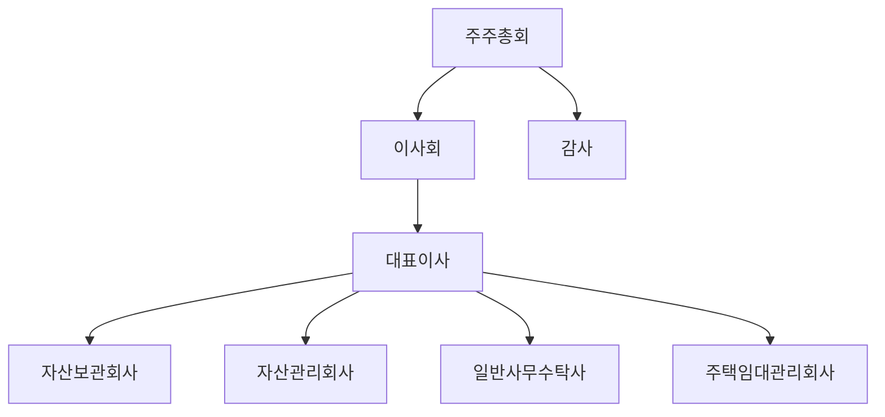
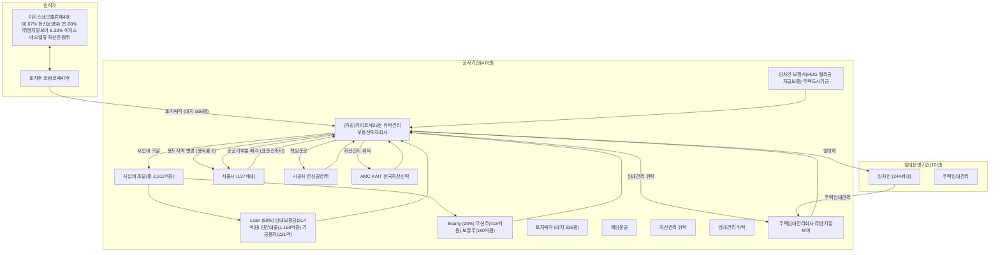

## 투자 설명서(안)

이 회사의 존속기한은 별도로 설정되어 있지 않으나 2037년에 해산할 계획을 가지고 있습니다. 따라서 부동산의 매각 지연 등으로 인하여 적기에 해산할 수 없을 경우 등으로 인한 투자위험이 존재합니다.

1. **회 사 명** : 주식회사 카이트제이십삼호위탁관리부동산투자회사

   **본 점 소 재 지** : 서울시 강남구 테헤란로 306 (역삼동, 카이트타워)

   **(전 화) : 02-2112-6424**

   **대 표 이 사** : 손 상 익

2. **모 집 가 액** : 10,000원

3. **모집하고자 하는 주식의 종류 및 수** : 우선주식 4,180,000주
                                        보통주식 1,800,000주

4. **청 약 기 간** : -

5. **청 약 장 소** : 서울시 강남구 테헤란로 306 (역삼동, 카이트타워)

6. **납 입 기 일** : -

7. **납 입 장 소** : -

8. **투자설명서 비치 및 공시장소** : 서울시 강남구 테헤란로 306(역삼동, 카이트타워)

이 투자설명서는 국토교통부장관이 그 내용이 진실 또는 정확하다는 것을 인정하거나 당해 주식의 가치를 보증 또는 승인하는 것이 아니며, 투자원금도 보장되지 않기 때문에 투자에 신중을 기하여 주시기 바랍니다.

- 1 -

## 제1부 모집의 개요

### I. 모집의 요령

#### 1. 모집주식의 내용

<table><tr><th>구 분</th><th>종 류</th><th>모집주수</th><th>주당발행가액</th><th>모집총액</th><th>비고</th></tr>
<tr><td rowspan="2">모집(사모)</td><td>기명식 우선주식</td><td>4,180,000주</td><td>10,000원</td><td>41,800,000,000원</td><td></td></tr>
<tr><td>기명식 보통주식</td><td>1,800,000주</td><td>10,000원</td><td>18,000,000,000원</td><td></td></tr>
<tr><td colspan="2"><strong>합 계</strong></td><td>5,980,000주</td><td>10,000원</td><td>59,800,000,000원</td><td></td></tr></table>

#### 2. 모집의 방법

<table>
  <thead>
    <tr>
      <th colspan="2">모 집 대 상</th>
      <th>주수(%)</th>
      <th>주당
모집가액</th>
      <th>모집총액</th>
      <th>비고</th>
    </tr>
  </thead>
  <tbody>
    <tr>
      <td rowspan="5">모집
(사모
)</td>
      <td>㈜민간임대허브제
7호위
탁관리부동산투자회사
(
우선주)</td>
      <td>4,180,000주
(69.90%)</td>
      <td>10,000원</td>
      <td>41,800,000,000원</td>
      <td>현금</td>
    </tr>
    <tr>
      <td>한신공영㈜
(
보통주)</td>
      <td>1,066,700주
(17.84%)</td>
      <td>10,000원</td>
      <td>10,667,000,000원</td>
      <td>현금</td>
    </tr>
    <tr>
      <td>엠지알브이㈜
(
보통주)</td>
      <td>400,000주
(6.69%)</td>
      <td>10,000원</td>
      <td>4,000,000,000원</td>
      <td>현금</td>
    </tr>
    <tr>
      <td>이지스네오밸류자산운용㈜
(
보통주)</td>
      <td>133,300주
(2.23%)</td>
      <td>10,000원</td>
      <td>1,333,000,000원</td>
      <td>현금</td>
    </tr>
    <tr>
      <td>한국자산신탁주
( )
(
보통주)</td>
      <td>200,000주
(3.34%)</td>
      <td>10,000원</td>
      <td>2,000,000,000원</td>
      <td>현금</td>
    </tr>
    <tr>
      <td colspan="2">합 계</td>
      <td>5,980,000주
(100.0%)</td>
      <td>10,000원</td>
      <td>59,800,000,000원</td>
      <td>현금</td>
    </tr>
  </tbody>
</table>

#### 3. 인수에 관한 사항

해당사항 없음

– 2 –

## 4. 모집의 조건

<table><tr><th>항 목</th><th>내 용</th></tr>
<tr><td>모 집 주 식 의 수</td><td>5,980,000주</td></tr>
<tr><td>주 당 모 집 가 액</td><td>10,000원</td></tr>
<tr><td>청 약 단 위</td><td>1 주</td></tr>
<tr><td>청 약 기 일</td><td>-</td></tr>
<tr><td>청 약 증 거 금</td><td>100%</td></tr>
<tr><td>납 입 기 일</td><td>-</td></tr>
<tr><td>배 당 기 산 일 (결 산 일)</td><td>매년 1월 1일(12월 31일) - 설립년도 : 2022.08.18(12월 31일) - 청산년도 : 1월 1일(당해 회사 청산일)</td></tr></table>

## 5. 모집의 절차

### 가. 공고의 일자 및 방법

부동산투자회사법 제14조의8 제3항에 따라 모집주식 전체를 사모 모집 예정인 바, 공고는 이루어지지 않으며, 각 투자자들에게 개별적으로 청약 일정이 통보됩니다.

### 나. 청약방법

1) 모든 청약자는 "금융실명거래 및 비밀보장에 관한 법률"에 의한 실명자이어야 하며, 해당 청약사무취급처에 소정의 주식 청약서를 작성하여 청약증거금과 함께 제출하여야 합니다. (단 기관투자자는 청약증거금이 면제됨)
2) 청약은 해당 청약사무취급처에서 사전에 정하여 공시하는 청약방법에 따라 청약 가능하며, 최저 청약한도는 1주이며, 최고청약한도는 11,960,000주입니다.
3) 청약은 2022년 월 일에 실시될 예정입니다.

### 다. 청약취급처

당해 회사의 본점 (서울시 강남구 테헤란로 306, 카이트타워)

- 3 -

## 라. 청약결과 배정방법

사모로 진행되므로 청약 주식수대로 배정됩니다.

## 마. 주권교부에 관한 사항

주권의 발행 및 교부에 관하여는 납입절차가 완료된 후 개별 통보합니다.

## 6. 기타 모집에 관한 사항

### 가. 주권교부일 이전의 주식양도의 효력

주권교부일 이전에 주식 양도 시에는 회사에 대하여 지명채권의 양도에 관한 일반원칙에 따라 양도인인 주주가 회사에 양도사실을 통지하거나 회사로부터 승낙을 얻은 경우에는만 회사 기타 제3자에게 대항할 수 있습니다.

### 나. 청약증거금의 대체 및 반환 등에 관한 사항

해당사항 없음

### 다. 납입일 및 주금납입장소

해당사항 없음

### 라. 기타의 사항

해당사항 없음

## Ⅱ. 기타 투자자보호에 필요한 사항

### 1. 주식의 상장 또는 거래에 관한 사항

회사는 신주발행을 사모형식으로 모집하며 부동산투자회사법 제20조 제1항에 따라 자본시장과 금융투자업에 관한 법률 제390조 제1항에 따른 상장규정의 상장이요건을 갖추게 되기 전까지는 증권거래소에 상장할 계획이 없으므로, 환급성 및 유동성이 제한될 수 있습니다.

- 4 -

## 2. 기타 중요한 사항

가. 당해 회사는 국토교통부 장관으로부터 영업인가를 받은 후 신주모집이 완료되는 즉시 국토교통부장관에게 부동산투자회사법 제10조의 “최저자본금준비 기간” 내에 최저자본금이 준비완료 되었음을 통지할 예정입니다.

나. 회사는 국토교통부 장관으로부터 영업인가를 받지 못하는 경우에는 기존 주주가 아닌 자에게 배정하는 방식으로 신주를 발행할 수 없으므로 이러한 경우에 한하여 주식의 인수청약예정자는 당해 청약을 거부할 수 있습니다.

다. 기존주주의 인수청약이 있는 주식의 수가 회사 신주 발행 시에 발행하는 주식의 수에 미달하는 때에는 회사는 실권주 배정을 위하여 납입기일을 연기할 수 있으며 회사는 신주의 인수인이 납입을 하지 않는 경우 상법 제423조 제3항에 따라 손해배상을 청구할 수 있습니다.

라. 당해 회사의 주식에 대한 투자는 관련 법령상 원리금 보호대상이 아니므로 투자자는 투자원금에 대한 손실을 입을 위험이 있습니다. 투자에서 발생하는 손실은 주주인 투자자가 전적으로 책임을 져야 하고 투자자 이외의 어떠한 자도 투자손실에 대한 책임을 지지 않습니다.

마. 당해 회사에 투자를 함에 있어서 유의하여야 할 중요한 사항으로는 다음과 같은 사항이 있습니다.

1) 투자원금에 대한 손실의 위험
2) 부동산 자산의 매입, 운용, 처분 관련 위험(소유권 제한의 위험, 물리적, 기술적 하자로 인한 추가비용 부담의 위험, 임차인의 신용 위험, 공실 위험, 관리비용 증가 비용, 역부채 효과 위험, 재해 등 불가항력에 대한 위험 등)
3) 환금성 및 유동성 관련 위험(환금성 등 주식 관련 위험, 유동성 관련 위험)
4) 회사 경영 및 운영 등 기타 위험(대리인 및 이해상충 관련 위험, 제도 변화관련 위험, 현금 및 증권의 운용관련 위험)

※ 상기 투자와 관련하여 고려하여야 하는 사항에 대한 자세한 설명은 본 투자 설명서 「제2부 「Ⅲ.투자방침 및 이익 등의 분배방법」의 「3.투자와 관련된 위험」을 참조하시기 바랍니다.

- 5 -

## 제2부 발행인에 관한 사항

### I. 회사의 개황

#### 1. 회사의 사업목적

가. 명 칭 : 주식회사 카이트제이십삼호위탁관리부동산투자회사
나. 설립일 : 2022. 08. 18.
다. 소재지 : 서울시 강남구 테헤란로 306 (역삼동, 카이트타워)

#### 2. 회사의 설립취지 및 그 성격

당해 회사는 부동산투자회사법에 따라 설립되는 회사로서 (주)민간임대허브제7호위탁관리부동산투자회사(주택도시기금), 이지스네오밸류일반사모부동산투자신탁제4호, 한국자산신탁(주)로부터 자금을 확보하여 코람코전문투자형사모부동산투자신탁제47호로부터 토지를 취득하고 시공사 한신공영(주)을 선정하여 공동주택을 건설하고 자산관리회사인 한국자산신탁(주)가 임대 운영, 관리, 임대기간 종료 후 일반분양하여 발생한 수익을 주주에게 배당하는 것을 목적으로 합니다. 주택가격의 상승없이도 IRR 3.09%의 출자자 수익이 발생할 수 있도록 사업성을 확보하여 사업구조를 표준화함으로써 투자자들에게 안정적인 투자수익을 제공하여 부동산 간접투자제도 활성화에 기여함을 목적으로 하고 있습니다.

#### 3. 회사의 구조

당해 회사의 자산은 자산관리회사인 한국자산신탁(주)에 의하여 운용될 것이고, 엔에이치투자증권(주)이 자산보관회사로서 현금 및 증권의 보관, 현금자산 운용지시의 이행, 부동산의 등기부상 소유권의 보전관리업무를 담당할 것이며, 신한아이타스(주)가 일반사무수탁회사로서 회사의 운영 및 계산에 관한 사무, 주식발행사무 등을 수행할 것입니다. 다음은 당해 회사의 구조를 도표화한 것입니다.

flow_chart: organizational chart of the company structure

- 6 -

## 4. 주식에 관한 사항

<table><tr><th>발행할 주식의 총수</th><th>최저자본금준비기간 이내에 발행하는 주식의 총수</th><th>발 행 가 액</th></tr>
<tr><td>5,980,000주</td><td>5,980,000주</td><td>59,800,000,000원</td></tr></table>

## 5. 주식사무에 관한 사항

<table><tr><th>구 분</th><th>내 용</th></tr>
<tr><td>결산일</td><td>매년 12월 31일</td></tr>
<tr><td>정기주주총회</td><td>매 결산기 종료 후 3월 이내</td></tr>
<tr><td>주주명부폐쇄시기</td><td>매 결산기 최종일 익일부터 그 결산기에 관한 정기 주주총회 종료일까지</td></tr>
<tr><td>공고계재신문</td><td>한국경제신문</td></tr>
<tr><td>주권의종류</td><td>우선주, 보통주</td></tr>
<tr><td>명의개서업무</td><td>일반사무수탁회사</td></tr></table>

## 6. 정관에 정한 존속기간 및 해산사유

가. 존립기간을 정한 경우 그 존립기간의 만료
    (단, 현재 회사 정관상 존립기간은 규정되어 있지 않음)
나. 주주총회의 결의
다. 합병
라. 파산
마. 법원의 해산명령 또는 해산관결
바. 국토교통부장관의 설립인가의 취소
사. 부투법 제3조부터 제7조까지의 규정을 위반하여 영업인가 또는 등록이
    거부된 경우
아. 설립 후 1년 6개월 이내에 영업인가를 받지 못하거나 등록을 하지 못한
    경우

## 7. 주식환매에 관한 사항

당해 회사는 폐쇄형 명목회사(Paper Company)로서 당해 회사의 주식에 대하여는 원칙적으로 환매가 제한되므로 이에 따른 환급성 위험과 주식가치 하락에 따른 자본손실 위험이 있습니다.

- 7 -

## II. 발기인.이사 및 감사에 관한 사항

### 1. 발기인에 관한 사항

<table><tr><th>성 명</th><th>법인등록번호</th><th>주요경력 또는 연혁</th><th>비 고</th></tr>
<tr><td>오창수</td><td>640325-1*******</td><td>2003년~현재, 오창수 법무사 사무소 대표</td><td>-</td></tr></table>

### 2. 이사 및 감사에 관한 사항

<table>
  <thead>
    <tr>
      <th>직 위</th>
      <th>성 명</th>
      <th>주민번호</th>
      <th>현소속</th>
    </tr>
  </thead>
  <tbody>
    <tr>
      <td>대표이사</td>
      <td>손상익</td>
      <td>771226-1******</td>
      <td>한신공영
(
주)</td>
    </tr>
    <tr>
      <td>이사</td>
      <td>반웅기</td>
      <td>860901-1******</td>
      <td>한신공영
(
주)</td>
    </tr>
    <tr>
      <td>이사</td>
      <td>박기수</td>
      <td>770829-1******</td>
      <td>경북 법무법인</td>
    </tr>
    <tr>
      <td>감사</td>
      <td>권오성</td>
      <td>820521-1******</td>
      <td>이촌 회계법인</td>
    </tr>
  </tbody>
</table>

### 3. 임원의 보수지급기준

이사 및 감사의 보수는 1인당 월 일백만원(₩1,000,000) 이내에서 주주총회 결의로 정할 예정입니다.

– 8 –

## Ⅲ. 투자방침 및 이익 등의 분배방법

본 투자설명서의 투자방침 및 이익 등의 분배방법에 관한 사항은 장래 예측에 대한 정확성을 판단하거나 실현 가능성을 보증하는 것은 아니며 향후 경제상황이나 제반 여건의 변화에 따라 그 내용이나 결과가 달라질 수 있습니다.

### 1. 자산운용의 기본방침

당해 회사는 부동산투자회사법에 따라 설립되는 회사로서 (주)민간임대허브제7호 위탁관리부동산투자회사(주택도시기금), 이지스네오벨류일반사모부동산투자신탁제4호, 한국자산신탁(주)로부터 자금을 확보하여 코람코전문투자형사모부동산투자신탁제47호로부터 토지를 취득하고 시공사 한신공영(주)을 선정하여 공동주택을 건설하고 자산관리회사인 한국자산신탁(주)이 임대 운영, 관리, 임대기간 종료 후 일반 분양하여 발생한 수익을 주주에게 배당하는 것을 목적으로 합니다. 주택가격의 상승 없어도 IRR이 최소 3.09%의 출자자 수익이 발생할 수 있도록 사업성을 확보하였고, 사업구조를 표준화함으로써 투자자들에게 안정적인 투자수익을 제공할 계획입니다.

당해 회사의 부동산 매입 임대, 운영사업에 투자·운용하지 아니하는 여유 자금은 금융기관에의 예치, 국채·공채의 매매, 「공공기관의 운영에 관한 법률」에 따른 공공기관에서 발행한 채권의 매매, 「은행법」에 따라 설립된 은행이 발행 또는 보증한 채권의 매매 중 어느 하나에 해당하는 방법으로 투자 운용할 계획이며, 부동산의 매입, 개발, 임대, 운영, 관리, 처분 등의 업무를 한국자산신탁(주)으로 하여금 대행하도록 하고 기타 여유자금은 당해 회사의 이사회에서 운용방침을 정하여 한국자산신탁(주)을 통해 운용할 계획입니다.

또한 회사는 법령을 준수하고 주주를 보호하기 위하여 그 소속 임직원이 그 자산을 투자·운용함에 있어 따라야 할 내부통제기준 등 기본적인 절차와 기준 등을 제정하여 시행할 것입니다.

#### 가. 부동산의 매입

(단위: 백만원)

<table><tr><th>구 분</th><th>금 액</th><th>산정근거</th></tr>
<tr><td>토지비</td><td>104,698</td><td>토지매입비, 취득세, 자문수수료 등</td></tr>
<tr><td>건축사업비</td><td>84,388</td><td>직접공사비, 간접공사비, 설계.감리비, 각종 부대비용, 건설관련 예비비 등</td></tr>
<tr><td>합 계</td><td>189,085</td><td></td></tr></table>

- 9 -

## 나. 부동산의 개발

공동주택 건축을 위해 시공사인 한신공영(주)의 책임준공을 통하여 준공에 대한 안정성을 확보할 계획입니다.

## 다. 부동산의 운영 및 관리

1) 당사는 입주자 모집 전 충분한 홍보 및 마케팅을 실시하여 입주자 모집을 극대화할 계획입니다.

2) 원활한 임대운영, 관리를 위해 한국자산신탁(주)을 자산관리자로 선정하여, 사업기간 내 임대운영, 매각업무 등을 위탁할 계획이며, (주)앰지알브이가 주택임대관리서비스를 제공하여 전문적이고 체계화된 관리시스템을 통한 효과적인 임대운영 및 원활한 매각이 가능할 것으로 판단됩니다.

## 라. 부동산의 처분

당해 회사는 한시적인 명목 회사로 청산시점에 배당 가능한 사업수익률을 확보 하여야 하나 임대기간 종료 후 부동산에 매각 위험이 상존합니다. 따라서 당사는 다음과 같이 계획적인 매각전략을 세워 부동산을 매각할 계획입니다.

1) 일반분양을 통해 사업을 청산하거나,
2) 분양전환기간 도래 시 다양한 분양전환 활성화 방안으로 임차인 우선분양 후 잔여분에 대하여 일반인 분양을 실시할 계획입니다.
3) 청산시에는 임대시장 수급여건 및 최적 매각시기를 검토하여 미매각물량 기관 매각 또는 임대기간 연장을 위한 리파이낸싱을 추진할 계획입니다.
4) 매각 시에는 부동산투자회사법 제24조 제3항에 의거, 아래 내용이 포함된 실사보고서를 작성할 것입니다.
    ① 당해 부동산의 현황 및 거래비용
    ② 당해 부동산과 관련된 재무자료
    ③ 당해 부동산의 수익에 영향을 미치는 요소
    ④ 그 밖에 당해 부동산의 거래 여부를 결정함에 있어 필요한 사항으로서 국토교통부령이 정하는 사항

- 10 -

## 2. 투자대상자산 및 사업운영계획

### 가. 사업개요

<table><tr><th colspan="2">구 분</th><th>내 역</th></tr>
<tr><td rowspan="7">개발 계획</td><td>대지위치</td><td>서울특별시 성동구 도선동 286 일원</td></tr>
<tr><td>대지면적</td><td>3,093.00m2</td></tr>
<tr><td>건 폐율</td><td>59.99%</td></tr>
<tr><td>용 적률</td><td>961.84%</td></tr>
<tr><td>규 모</td><td>지하7층/지상27층</td></tr>
<tr><td>공급세대수</td><td>공동주택 총 381세대(공공임대 137세대, 민간임대 244세대) 및 인근생활시설</td></tr>
<tr><td>평형구성</td><td>18형, 49형, 53형, 59형</td></tr>
<tr><td rowspan="6">개발 비용</td><td>토지 관련</td><td>104,698백만원</td></tr>
<tr><td>건설 관련</td><td>84,487백만원</td></tr>
<tr><td>리츠운용</td><td>1,959백만원</td></tr>
<tr><td>부동산관리</td><td>456백만원</td></tr>
<tr><td>금융비용</td><td>20,820백만원</td></tr>
<tr><td>합 계</td><td>211,977백만원</td></tr>
<tr><td>토지매매계약</td><td colspan="2">2023.02</td></tr>
<tr><td>착 공</td><td colspan="2">2023.02</td></tr>
<tr><td>공사기간</td><td colspan="2">48개월</td></tr>
<tr><td>준 공</td><td colspan="2">2027.01</td></tr></table>

. 서울시 성동구 도선동 286번지 일원에 역세권청년주택(공공지원 민간임대주택)을 건설해, 18타입부터 59타입까지 공동주택 381세대(공공임대 137세대, 민간임대 244세대) 및 인근생활시설을 공급할 예정입니다. 토지매매계약은 2023년 2월에 이루어질 예정이고, 임대주택은 2023년 2월에 착공되어 48개월의 공사기간 후 2027년 1월에 준공 예정입니다

- 11 -

. 개발비용은 토지매입비 ·취득세 등 ·공사비 ·기타부대비용을 모두 합하여 211,977백만원이 발생할 것으로 예상되며, 개발비용은 ㈜민간임대허브제7호위탁 관리부동산투자회사(우선주) 및 한신공영㈜(보통주), ㈜앰지알브이(보통주), 이지스네오밸류자산운용㈜(보통주), 한국자산신탁㈜(보통주)이 자본금을 출자하고 잔여 필요 자금은 임대보증금, 주택도시기금융자, 민간차입자본으로 조달할 예정입니다. 민간차입자본은 주택도시보증공사가 상환을 보증하는 방식으로 조달할 예정입니다.

## 나. 사업구조

flow_chart: Project structure diagram for Isisneo Valley Zone 4

## 다. 재원조달금액 상세내역

회사는 자본금의 30.1%를 보통주, 69.9%를 우선주로 하고, 자본금의 2.6배의 상당액은 기금융자 및 민간차입금으로 조달할 예정입니다. 부동산 투자회사의 재원조달내역은 다음과 같습니다.

<table>
  <thead>
    <tr>
      <th colspan="2">자금조달 구조</th>
      <th>비율(%)</th>
      <th>금 액
(
백만원)</th>
    </tr>
  </thead>
  <tbody>
    <tr>
      <td colspan="2">임대보증금 등</td>
      <td>31.41%</td>
      <td>91,435</td>
    </tr>
    <tr>
      <td colspan="2">주택도시기금융자주1)</td>
      <td>7.92%</td>
      <td>23,050</td>
    </tr>
    <tr>
      <td colspan="2">민간차입금주2)</td>
      <td>40.13%</td>
      <td>116,817</td>
    </tr>
    <tr>
      <td rowspan="5">자본금</td>
      <td>㈜민간임대허브제
7호위탁관리부동산투자회사
(
우선주)</td>
      <td>14.36%</td>
      <td>41,800</td>
    </tr>
    <tr>
      <td>한신공영
㈜(
보통주)</td>
      <td>3.66%</td>
      <td>10,667</td>
    </tr>
    <tr>
      <td>㈜엠지알브이
(
보통주)</td>
      <td>1.37%</td>
      <td>4,000</td>
    </tr>
    <tr>
      <td>이지스네오밸류자산운용
㈜(
보통주)</td>
      <td>0.46%</td>
      <td>1,333</td>
    </tr>
    <tr>
      <td>한국자산신탁
㈜(
보통주)</td>
      <td>0.69%</td>
      <td>2,000</td>
    </tr>
  </tbody>
</table>

| – 12 –

<table><tr><td>합 계</td><td>100.00%</td><td>291,102</td></tr></table>

주1) 주택도시기금 융자

주2) 민간차입금

주3) 우선주

회사는 본 주식 청약에 의해 우선주 자본금이 41,800백만원이 되도록 (주)민간임대허브제7호위탁관리부동산투자회사(주택도시기금)의 납입자본으로 증자할 예정입니다.

주4) 보통주

회사는 본 주식 청약에 의해 보통주 자본금이 18,000백만원이 되도록 한신공업(주)(보통주), (주)엠지알브이(보통주), 이지스네오밸류자산운용(주)(보통주), 한국자산신탁(주)(보통주)가 납입자본으로 증자할 예정입니다.

주택도시기금융자의 취급조건은 다음과 같으며, 추후 변동 될 수 있습니다.

<table><tr><th>구 분</th><th>내 용</th></tr>
<tr><td>이자율</td><td>연 2.26 %</td></tr>
<tr><td>만기</td><td>최초 인출일로부터 13년</td></tr>
<tr><td>이자지급조건</td><td>1개월 후급</td></tr>
<tr><td>차입방식</td><td>한도 인출 방식</td></tr>
<tr><td>상환조건</td><td>만기 일시 상환</td></tr></table>

민간대출의 취급조건은 다음과 같으며, 추후 변동 될 수 있습니다.

<table><tr><th>구 분</th><th>내 용</th></tr>
<tr><td>이자율</td><td>연 6.00 %</td></tr>
<tr><td>만기</td><td>최초 인출일로부터 13년</td></tr>
<tr><td>이자지급조건</td><td>1개월 후급</td></tr>
<tr><td>차입방식</td><td>한도 인출 방식</td></tr>
<tr><td>상환조건</td><td>여유자금 상환</td></tr></table>

## **라. 사업추진일정**

<table><tr><th>일정</th><th>주요 업무</th></tr>
<tr><td>2022.08.</td><td>(주)카이트제이십삼호부동산투자회사 설립</td></tr>
<tr><td>2022.12.</td><td>HUG 기금출자심의위원회 출자 승인 - 이상 완료-</td></tr>
<tr><td>2023.02.</td><td>리츠영업인가 - 이하 예정 -</td></tr>
<tr><td>2023.02.</td><td>토지매매계약 체결</td></tr>
<tr><td>2023.02.</td><td>착공</td></tr></table>

- 13 -

<table><tr><td>2027.01.</td><td>준공</td></tr>
<tr><td>2027.02.</td><td>임대운영 개시</td></tr>
<tr><td>2037.01.</td><td>임대운영 종료 (임대운영기간 약 10년)</td></tr>
<tr><td>2037.04.</td><td>매각</td></tr>
<tr><td>2037.07.</td><td>청산</td></tr></table>

## **마. 임대공급계획**

한국부동산원 시세조사결과 대비 당 사업지 일반공급 임대조건율은 90% 수준이며, 특별공급 임대조건율은 85% 수준임

(단위:m2, 천원)

<table>
  <thead>
    <tr>
      <th colspan="2" rowspan="2">구분</th>
      <th rowspan="2">세대
수</th>
      <th rowspan="2">전용
면적</th>
      <th colspan="2">임대료</th>
      <th colspan="2">전세</th>
      <th rowspan="2">전세환산가
(
부동산원)</th>
      <th rowspan="2">임대
조건율</th>
    </tr>
    <tr>
      <th>보증금</th>
      <th>월세</th>
      <th>전환율</th>
      <th>전환가</th>
    </tr>
  </thead>
  <tbody>
    <tr>
      <td rowspan="7">일반
공급</td>
      <td>49A
형</td>
      <td>48</td>
      <td>49.31</td>
      <td>207,000</td>
      <td>893</td>
      <td>4.0</td>
      <td>267,900</td>
      <td>474,900</td>
      <td>94.95%</td>
    </tr>
    <tr>
      <td>49B
형</td>
      <td>6</td>
      <td>49.31</td>
      <td>207,000</td>
      <td>893</td>
      <td>4.0</td>
      <td>267,900</td>
      <td>474,900</td>
      <td>94.95%</td>
    </tr>
    <tr>
      <td>49C
형</td>
      <td>13</td>
      <td>49.30</td>
      <td>207,000</td>
      <td>893</td>
      <td>4.0</td>
      <td>267,900</td>
      <td>474,900</td>
      <td>94.95%</td>
    </tr>
    <tr>
      <td>49D
형</td>
      <td>66</td>
      <td>49.34</td>
      <td>208,000</td>
      <td>890</td>
      <td>4.0</td>
      <td>267,000</td>
      <td>475,000</td>
      <td>95.00%</td>
    </tr>
    <tr>
      <td>53
형</td>
      <td>13</td>
      <td>53.02</td>
      <td>220,000</td>
      <td>1,193</td>
      <td>4.1</td>
      <td>349,171</td>
      <td>569,171</td>
      <td>94.97%</td>
    </tr>
    <tr>
      <td>59A
형</td>
      <td>37</td>
      <td>59.89</td>
      <td>248,000</td>
      <td>1,322</td>
      <td>3.8</td>
      <td>417,474</td>
      <td>665,474</td>
      <td>94.96%</td>
    </tr>
    <tr>
      <td>59B
형</td>
      <td>12</td>
      <td>59.74</td>
      <td>246,000</td>
      <td>1,333</td>
      <td>3.8</td>
      <td>420,947</td>
      <td>666,947</td>
      <td>94.98%</td>
    </tr>
    <tr>
      <td colspan="2">소계</td>
      <td>195</td>
      <td></td>
      <td></td>
      <td></td>
      <td></td>
      <td></td>
      <td></td>
      <td></td>
    </tr>
    <tr>
      <td rowspan="4">특별
공급</td>
      <td>18A
형</td>
      <td>17</td>
      <td>18.52</td>
      <td>73,000</td>
      <td>467</td>
      <td>5.5</td>
      <td>101,891</td>
      <td>174,891</td>
      <td>69.96%</td>
    </tr>
    <tr>
      <td>18B
형</td>
      <td>14</td>
      <td>18.52</td>
      <td>73,000</td>
      <td>467</td>
      <td>5.5</td>
      <td>101,891</td>
      <td>174,891</td>
      <td>69.96%</td>
    </tr>
    <tr>
      <td>18C
형</td>
      <td>14</td>
      <td>18.52</td>
      <td>73,000</td>
      <td>467</td>
      <td>5.5</td>
      <td>101,891</td>
      <td>174,891</td>
      <td>69.96%</td>
    </tr>
    <tr>
      <td>49A
형</td>
      <td>4</td>
      <td>49.31</td>
      <td>175,000</td>
      <td>583</td>
      <td>4.0</td>
      <td>174,900</td>
      <td>349,900</td>
      <td>69.96%</td>
    </tr>
    <tr>
      <td colspan="2">소계</td>
      <td>49</td>
      <td></td>
      <td></td>
      <td></td>
      <td></td>
      <td></td>
      <td></td>
      <td></td>
    </tr>
    <tr>
      <td colspan="2">상가 2
층</td>
      <td></td>
      <td>1,260.00</td>
      <td>180,000</td>
      <td>35,890</td>
      <td>7.4</td>
      <td>5,820,000</td>
      <td>6,000,000</td>
      <td>100.00%</td>
    </tr>
    <tr>
      <td colspan="2">상가 1
층</td>
      <td></td>
      <td>1,078.76</td>
      <td>272,308</td>
      <td>54,295</td>
      <td>7.4</td>
      <td>8,804,595</td>
      <td>9,076,903</td>
      <td>100.00%</td>
    </tr>
    <tr>
      <td colspan="2">상가 지하</td>
      <td></td>
      <td>957.01</td>
      <td>162,074</td>
      <td>32,315</td>
      <td>7.4</td>
      <td>5,240,270</td>
      <td>5,402,344</td>
      <td>100.00%</td>
    </tr>
  </tbody>
</table>

* 임대시세 및 전세전환율 = 한국부동산원 시세조사서 기준
* 전세환산가 = 월임대료 × 12 / 전세환산이율 + 임대보증금
* 임차인모집시 보증금 및 임대료 비율, 임차대상 등은 시장상황 및 승인권자 협의의견에 따라 조정 예정

## **바. 임대운영 및 관리계획**

- 주거가치 향상을 위한 임대운영 및 관리계획을 수립하였으며, 자산관리회사인 한국자산신탁(주)의 총괄하에 전문 임대관리업체인 (주)엠지알브이를 통해 단계별 임대운영 관리 계획으로 최적의 임대관리서비스를 제공할 예정입니다.

- 14 -

<table>
  <thead>
    <tr>
      <th>구 분</th>
      <th>AMC</th>
      <th>임대관리</th>
      <th>주택관리</th>
      <th>시공 /하자보수</th>
    </tr>
  </thead>
  <tbody>
    <tr>
      <td>업체명</td>
      <td>한국자산신탁㈜</td>
      <td>엠지알브이㈜</td>
      <td>미정</td>
      <td>한신공영㈜</td>
    </tr>
    <tr>
      <td>투입인원</td>
      <td>본사 2명</td>
      <td>본사 1 명,
상주 1명</td>
      <td>현장 상주 19명</td>
      <td>CS센터</td>
    </tr>
    <tr>
      <td>업무분장</td>
      <td>· 투자분석
· 투자계획 수립
· 투자회사 설립
· 투자재원 조달
· 투자대상 발굴
· 투자대상 운영
· 투자대상 처분</td>
      <td>· PM/FM/LM 총괄
· 임대 마케팅 /홍보
· 임차인 모집
· 임대차 계약
· 수금 관리
· 입주 관리
· 공실률 관리
· 입주자 문의 대응
· 연체자 관리
· 보고서 작성 등</td>
      <td>· 시설 유지 보수
· 경비 보안 업무
· 미화 업무
· 경리 업무
· 입주자커뮤니티 지
원 업무</td>
      <td>· 분야별 하자보수
인력 투입
· 입주지원센터운영
· 현장 AS센터운영</td>
    </tr>
  </tbody>
</table>

* 시설별 주거서비스 운영계획을 수립했으며, 입주민 만족도 제고를 통한 단지 활성화 및 안정화 진행 예정입니다.

* 공급세대 특성 및 인근 수요를 고려한 특화 마케팅 진행해, 입주율 극대화 예정입니다.

– 15 –

<table><tr><th></th><th>임대관리 주요업무</th><th>업무프로세스</th><th colspan="4">세부업무 프로세스</th></tr>
<tr><td><strong>입주 전 01</strong></td><td>• 입주자 모집공고 지원 • 임대분양 계약서 지원 • 입주매뉴얼 작성 - 입주지정기간 선정 등 • 입주가이드북 작성 - 세대 내 시설물 사용법 - 커뮤니티 안내 • 관리규약 및 규정 제작 • 공동기금 활용 안내 • 건물화재보험 가입 • 주거서비스 인증 예정 (입주민 모집공고일 3개월 전까지 완료)</td><td>마케팅 시작  마케팅(SNS광고, 대중교통광고, 홈페이지 광고)을 통한 임차수요 확보 후 사전 계약체결</td><td>마케팅 시작  • 임대 광고 • 입주자 모집 공고 • 입주계획 수립</td><td>주거서비스 실행계획  • 서비스 매니저 선정 • 서비스 유형 기획 (청년, 커뮤니티 특화, 공유주방, 소모임) • 모니터링 계획 (인원산정 및 예산 마련)</td><td>운영체계 구축  • 입주매뉴얼 작성 • 입주가이드북 제작 • 공동기금 활용 안내 책자 제작 • 관리규약 제작</td></tr>
<tr><td><strong>입주시 02</strong></td><td>• 입주절차 진행 • 입주지원센터 운영 - 이사 스케줄표 작성 - 관리규약 및 규정, 공동기금 활용 동의 - 입주자 및 주차카드 발급 • 인테리어공사 약정서 체결 • 주차관리 임대업체 선정</td><td>입주지원센터 운영  세대내부 시설물 인계 및 이사일정 조정</td><td>이사 스케줄 확인, 조정</td><td>세대내부 시설물 점검 및 개량 검침</td><td>열식분출 가이드북 설명 및 관리규약 체결</td><td>입 주 (E/L예약)</td><td>입주민족도 조사 및 피드백</td></tr>
<tr><td><strong>입주 중 03</strong></td><td>• 월 임대료 및 관리비 안내 • 이사 동선 보양작업 확인 • 임차인 민원 관리 • 입주민 주거 만족도 조사 • 입주민 주거서비스 모니터링 • 임차대기자 관리 • 공실관리</td><td>입주지원센터 운영  임차인 민원  주거서비스항상  공실관리</td><td>• 임대료 및 관리비남부 편이성 강화로 체납률 최소화 - 납부일 지정제도, 세대별 가상계좌 운영, 납부 7일전 사전 통보</td><td colspan="3">• 민원별 대응 매뉴얼(Q&#x26;A 등) 및 체계 구축</td><td colspan="2">• 홈페이지 운영으로 정기적인 설문조사 후 만족도 항상</td></tr>
<tr><td></td><td></td><td></td><td colspan="5">• 임차인 재계약율 향상과 대기수요자 관리로 공실 최소화</td></tr>
<tr><td><strong>퇴거시 04</strong></td><td>• 관리비 및 임대비용 정산 • 입주민 만족도 설문조사 • 세대내부 시설물 확인 - 복구비용 산정 및 협의</td><td>3개월 전 신청서 접수  사전퇴실 예정인원 관리 입주 대기자 우선 분양</td><td>퇴거 신청 → 입주민 자체점검 및 내용전달 → 이사짐 반출 시설체크 → 원상복구비 협의 → 보증금 반환 원상복구</td><td>자유퇴거(입주 1년후) 적용, 시행  입주 1년 후 60일전 통보 시 위약금 면제</td><td>원상복구 정산매뉴얼 이용 안내  명확한 책입구분/ 표준복구비용정산</td></tr>
<tr><td><strong>임대종료 05</strong></td><td>• 주민만족도 설문조사 실시 • 체크리스트를 통한 현상태 확인 및 조치</td><td>분양 전환 입주민 응대 프로세스 운영</td><td colspan="4">• 입주민 원활한 인수인계를 위한 분양전환 입주민 응대 • 매입 예정 임차인을 위한 부동산 연계 서비스 제공</td></tr></table>

## **사. 매각(EXIT) 전략**

### (1) 운용기간(시장조사, 자산가치항상, DB 관리)

<table><tr><th>구 분</th><th>내 용</th></tr>
<tr><td>시장조사</td><td>. 주변 임대시장 및 주택시장 지속 모니터링</td></tr>
<tr><td>자산가치항상</td><td>. 입주자 만족도 조사 통한 피드백 제공으로 자산가치항상 노력</td></tr>
<tr><td>DB 관리</td><td>. 분양전환, 계속임대 및 퇴거 계획 조사를 통해 DB 관리 . 조사 참여도 높이는 방안 강구 (ex. 모바일참여 및 기프트콘 제공)</td></tr></table>

### (2) 청산시점(기관 매각, 분양전환, 계속임대)

<table><tr><th>구 분</th><th>내 용</th></tr>
<tr><td>금융시장 통매각</td><td>. 임대시장 활성화시, 금융시장(부동산투자회사, 연기금 등) 통매각을 통해 안정적으로 투자금 회수</td></tr>
<tr><td>분양 전환</td><td>. 선호도 조사를 통해 구축된 DB를 토대로 기존 임차인 우선분양 . 미전환 물량은 시장에서 일반인에게 분양 . 분양전환 가격 감정평가 실시</td></tr>
<tr><td>계속 임대</td><td>. 미매각 및 미분양 물량은 임대기간 연장을 위해 리파이낸싱 추진</td></tr></table>

- 16 -

## 3. 투자제한

1) 자산의 투자·운용에 관한 일반원칙
   회사는 관련 법령 및 정관의 규정에 따라 자산을 부동산 취득·개발·임대차 및 증권의 매매·금융기관에 예치 등의 방법으로 운용하게 됩니다. 또한 회사는 법령을 준수하고 주주를 보호하기 위하여 그 자산을 투자·운용함에 있어 소속 임직원이 따라야 할 내부통제기준 등 기본적인 절차와 기준 등을 제정·시행할 계획입니다.

2) 부동산에의 투자 및 운용
   회사가 부동산을 취득하거나 처분하는 경우에는 실사보고서를 작성하게 되며, 취득 또는 처分の 결정은 이사회 및 주주총회를 통하여 이루어집니다.
   회사는 최저자본금준비기간이 끝난 후에는 매분기말 현재 총자산의 100분의 80 이상을 부동산 또는 부동산 관련 증권 및 현금으로 구성되도록 하며, 총 자산의 100분의 70 이상은 부동산(건축중인 건축물을 포함한다)으로 구성하도록 하되, 자산의 구체적인 내용 및 산정기준 등은 부동산투자회사법 제 25조 및 동법 시행령에 의합니다.
   부동산투자회사법에 의한 부동산투자회사는 부동산을 취득한 후 부동산투자회사법 시행령 제26조 제1항이 정하는 기간 이내에는 이를 처분할 수 없습니다. 다만 부동산개발사업으로 조성하거나 설치한 토지·건축물 등을 분양하는 경우 그 밖에 투자자 보호를 위하여 부동산투자회사가 합병·해산·분할 또는 분할합병을 하는 경우에는 그러하지 아니합니다.

3) 부동산 개발사업의 투자 및 여유자금 운영
   회사는 개발전문 위탁관리 부동산투자회사로서 총자산의 전부를 부동산개발사업에 투자할 수 있습니다. 또한 부동산개발사업에 투자·운영하지 아니하는 여유자금은 1. 금융기관에의 예치 2. 국채·공채의 매매 3. 공공기관의 운영에 관한 법률에 따른 공공기관에서 발행한 채권의 매매 4. 은행법에 따라 설립된 은행이 발행 또는 보증한 채권의 매매 중 어느 하나에 해당하는 방법으로 투자·운영하여야 합니다.
   이와 관련하여 당해 회사의 이사회에서 운용방향을 정하여 한국자산신탁을 통해 운용할 계획입니다.

- 17 -

## **Ⅳ. 투자와 관련된 위험**

다른 주식 관련 투자와 같이, 회사주식에 대한 투자는 투자원금에 대하여 손실이 발생할 위험 등 다양한 위험을 수반합니다. 또한, 회사주식의 가치는 보장되지 아니하며 회사주식에 대한 투자로 인하여 투자자에게 발생 가능한 손실은 어떠한 방법으로도 보상되지 아니합니다.

### **1. 일반 위험**

#### **가. 투자원금에 대한 손실의 위험**

관계법령은 당해 회사와 같은 위탁관리부동산투자회사에 대한 투자에 대하여 원리금을 보장하거나 보호하지 않습니다. 따라서 전반적인 국가경제 및 부동산 시장의 상황에 따라 보유자산의 가치가 하락하는 경우에는 주식의 가치는 액면가 이하로 하락하거나 청산 시 부동산의 시장가격이 최초 예상보다 현저히 하락하는 경우에는 투자원금의 전부 또는 일부에 대한 손실의 위험이 존재합니다. 이와 같이 투자금액의 손실 내지 감소의 위험은 전적으로 투자자가 부담하며, 회사를 포함한 어떠한 당사자도 투자손실에 대하여 책임을 지지 아니합니다.

#### **나. 경기변동에 따른 위험**

부동산 시장은 국내 경기 등에 민감하게 작용하므로 전반적인 국내 경기의 침체는 분양가 및 분양물에 불리하게 작용할 수 있습니다. 이로 인해 실제 배당금이 회사의 사업계획서상의 예상배당금보다 낮아질 수 있으므로 투자 시 유의하시길 바랍니다.

### **2. 특수위험**

#### **가. 부동산자산의 개발 · 운용위험 관리계획**

당사가 사업부지를 매입하는 과정에서 고려할 수 있는 위험으로는 i)부동산 권리관계 및 이해관계자(채권자 등 제3자)의 이의 제기 등으로 인한 법적 하자로 인하여 완전한 소유권의 이전 및 권리 행사에 제약을 받을 수 있는 위험과 ii)부동산의 물리적, 기술적 하자로 인하여 매입검토 시에 예상하지 못하였던 일정금액 이상의 추가지출을 발생시킬 수 있는 위험, iii)운영과 관련한 자료의 불충분이나 분석의 착오로 인한 사업 수익성 검토상의 매입가격 추정오류의 위험 등을 들 수 있습니다. 다만, 실제 위험 발생가능성 및 그 결과에 대해 사전 분석을 통한 위험 최소화 방안을 마련하고, 부동산 매매계약 체결 등의 과정에서 이러한 위험을 적극적으로 회피하도록 만전을 기하였습니다.

단, 당해 회사는 코람코전문투자형사모부동산투자신탁제47호로부터 매매의 방식으로 부동산을 취득하며, 기타 가압류, 가처분 등 부동산에 대한 모든 부담은 소유권 이전등기 이전에 말소된 상태에서 매입할 예정입니다.

- 18 -

## 나. 부동산 개발 위험관리

부동산 개발기간 동안의 자산 운용과 관련하여 예측할 수 있는 위험으로는 다음 과 같은 위험이 발생할 수 있습니다.

1) 건축법상 건축허가 등의 위험

본 부동산을 개발하기 위한 건축법상 건축허가 등과 관련하여 건축심의, 건축허가 등 인허가상 위험요소들을 사전에 확인할 필요가 있습니다. 다만, 당 사업지는 코람코진문투자형사모부동산투자신탁제47호에서 공공지원 민간임대주택사업을 위해 2022년 1월 13일 건축허가를 완료한 사업지로서, 인허가 위험이 낮다고 판단됩니다. 공동주택을 건축하기 위한 일반적인 허가 절차인 건축심의, 선축허가 등 이외에는 과도한 법적인 규제 및 제한 사항이 없는 것으로 확인된 바, 본 사업계획에 맞추어 부동산을 개발하기 위한 인허가상 별다른 문제가 없을 것으로 예상됩니다.

2) 시공사 위험

당사는 개발사업의 목적물을 건설함에 있어 시공사의 자금경색, 파산 등의 이유로 공기를 제때 맞추지 못하거나 공사불능 상태에 빠지게 되면 회사의 배당수익이 하락할 위험이 있습니다.

3) 재해 등 불가항력에 대한 위험

건설기간 중 예측할 수 없는 손해에 대해서는 건설공사보험, 공사이행보증보험 등을 통하여 부보험으로써 그 리스크를 헛지할 계획입니다. 단, 지진, 홍수 등 불가항력에 의한 손실이 있는 경우 이는 보험에 의해 부보되지 아니하므로 당해 회사의 수익에 직접적으로 영향을 미치게 되고 이에 따라 배당이 감소될 수 있습니다.

## 다. 부동산 자산 운용 관련

1) 일반적으로 부동산 자산의 운용과 관련된 위험은 공실위험, 임차인의 신용 위험, 개선비용 및 관리비 증가 위험이 있습니다.

2) 동 사업은 준공 6개월 전 입주자 모집을 개시하여, 안정적인 임대운영이 가능하도록 계획하였습니다. 또한 자산관리회사인 한국자산신탁(주) 및 (주)엠지알브이의 역량 및 효과적인 운영을 통하여 운영기간 중 공실위험을 최소화하여 임대위험을 낮출 계획입니다.

3) 따라서, 당해 부동산의 운용과 관련된 위험의 종류는 첫째, 임차인의 신용 위험 둘째, 부동산 자산의 불가항력 등으로 인한 재해위험이 있습니다.

- 19 -

※ 임차인에게 보증금을 수취할 예정이므로 임차인의 신용위험은 상당 부분 해소될 것입니다.

4) 그리고, 당사는 개발사업 및 운영 시에 소요되는 차입금에 대한 이자율 상승에 대비하고자 고정금리로 대출금을 조달할 예정입니다.

## 라. 부동산 자산 처분 관련

당해 회사는 한시적 법인으로 청산시점에 첫째, 부동산의 처분위험과 둘째, 처분시 시장위험이 상존하고 있습니다.

첫째, 당해 회사는 한시적 명목회사로서 운용기간 동안 시장조사 및 DB관리 등을 통해 자산가치를 향상시켜 처분위험을 낮출 것입니다. 청산시점에 ①일반분양을 하거나 ② 기존 임차인 분양전환 및 일반인 분양을 통해 안정적으로 투자금을 회수하거나 ③ 미매각 및 미분양 물량은 임대기간 연장을 위한 리파이넌싱을 추진할 예정입니다.

둘째, 처분 시 시장위험과 관련하여 부동산 시장 악화로 매각 지연 및 리파이넌싱 지연이 발생할 경우 사업계획서상의 배당 수익률을 달성하지 못할 가능성은 있습니다.

## 마. 현금 및 유가증권의 운영

1) 현금 및 유가증권 운용규모를 최소화할 계획이나 임대료수취누적액과 사내 유보금이 있는 경우 이를 재원으로 취득하는 유가증권을 보유하게 됩니다. 당해 회사가 현금 및 유가증권 자산을 운용함에 있어서 직면하는 위험은 금리변동 위험이 있습니다.

2) 즉, 현금 및 유가증권의 운용수익의 증감은 전반적인 경제상황 및 금융 시장의 질적 변화, 정부의 재정 및 금융정책의 변화, 물가상승률 등에 따른 금리의 변동에 좌우될 것입니다.

3) 따라서 동 자산의 운용과 관련하여 대책이 필요한 바 당해 회사는 현금 및 유가증권의 운용방향을 이사회에서 결정하되, 운용원칙은 배당지급 의무를 성실히 수행할 수 있도록 안정성을 도모함과 동시에 수익률을 극대화하는 방향으로 추진할 계획입니다.

4) 또한 여유자금은 목표금리 이상으로 장기상품과 단기상품을 적절히 혼합하여 운용하고 주요 운용대상으로서 금리하락이 일정기간 예상될 때에는 국공채 및 고정금리부 예금자산, 금리상승이 일정기간 예상될 때는 변동 금리부

- 20 -

예금자산을 활용할 계획입니다.

## 3. 회사 경영 및 운영 위험 관리계획

### 가. 환금성 등 주식 위험 관련

1) 당 회사는 주주에게 회사의 안정적인 성장과 함께 존속기한 동안 배당수익을 분배할 계획입니다.

2) 그러나 당해 회사는 첫째, 폐쇄형 명목회사(Paper Company)로서 원칙상 환매가 제한되므로 이에 따른 환금성 위험과 둘째, 주식가치 하락에 따른 자본손실 위험이 있습니다.

### 나. 유동성 관련 위험

1) 당사의 주식은 비상장 예정이므로, 장외거래를 통하여 이사회 승인을 얻어 보유주식의 매각이 가능합니다.

2)当社 주식의 매각 시에 매수 수요가 충분하지 않을 경우, 기대하는 가격에 매각되기까지 장시간이 소요될 수 있으며 당시일 내에 매각을 원하는 경우 기대하는 가격보다 낮은 가격으로 매각하게 될 위험이 있습니다.

3) 앞서 언급한 바와 같이 유동성확보가 원활하지 않을 위험성이 있습니다.

### 다. 대리인 및 이해상충위험 관련

1) 당사는 명목 회사(Paper Company)로서 자산의 운용 및 관리를 외부기관에 위탁하여야 하므로 이와 관련된 대리인 위험에 노출되어 있습니다.

2) 이들 위탁회사들은 성실하게 업무를 수행할 것으로 판단되나 역량 부족과 업무 태만이 나타날 경우 당사의 수익에 부정적인 영향을 줄 수 있으며, 독립적인 업무 및 이익창출 활동을 더 우선시 할 경우 당사와의 이해와 상충될 가능성이 있습니다.

3) 따라서, 이러한 대리인 위험을 방지하기 위해 주주총회와 이사회 의 권한과 기능을 강화하여 위탁업무회사와의 계약해지 및 퇴출기준을 각 위탁계약서에 보다 구체적으로 규정할 계획이며, 내부통제 기준의 제정과 감사인 제도를 두어 당해 회사, 자산관리회사, 자산보관회사 및 일반사무관리회사간 이

- 21 -

해상층 소지를 줄일 계획입니다.

## 라. 제도변화 위험 관련

1) 당사는 부동산투자회사법에 의해 설립되었습니다.

2) 추후 불가피하게 법 개정과 제도변화가 있을 경우 회사의 현금흐름 및 수익률이 변동할 위험을 배제할 수 없습니다.

## 4. 투자제한

### 가. 자산의 투자·운용에 관한 일반원칙

회사는 관련 법령 및 정관의 규정에 따라 자산을 취득·임대차 및 증권의 매매·금융기관에 예치 등의 방법으로 운용하게 됩니다. 또한 회사는 법령을 준수하고 주주를 보호하기 위하여 그 자산을 투자·운용함에 있어 소속 임직원이 따라야 할 내부통제기준 등 기본적인 절차와 기준 등을 제정·시행할 계획입니다.

### 나. 부동산에의 투자 및 운용

1) 당해 회사는 그자산을 다음 각 호의 어느 하나에 해당하는 방법으로 투자 및 운용해야 합니다.
    ① 부동산의 취득·관리·개량 및 처분
    ② 주택건설사업
    ③ 부동산개발사업
    ④ 부동산의 임대차
    ⑤ 증권의 매매
    ⑥ 금융기관에의 예치
    ⑦ 지상권·임차권 등 부동산 사용에 관한 권리의 취득·관리·처분
    ⑧ 신택이 종료된 때에 신택재산 전부가 수익자에게 귀속하는 부동산 신택 수익권의 취득·관리·처분

2) 회사가 부동산을 취득하거나 처분하는 경우에는 한국자산신탁 주식회사에 서 실사보고서를 작성하게 되며, 취득 또는 처分の 결정은 이사회 및 주주총회를 통하여 이루어집니다.

3) 회사는 최저자본금준비기간이 끝난 후에는 매분기말 현재 총자산의 100분

- 22 -

의 80 이상을 부동산 또는 부동산 관련 증권 및 현금으로 구성되도록 하며, 총 자산의 100분의 70 이상은 부동산(건축중인 건축물을 포함한다)으로 구성하도록 하되, 자산의 구체적인 내용 및 산정기준 등은 부동산투자회사법 제 25조 및 동법 시행령에 의합니다.

부동산투자회사법에 의한 부동산투자회사는 부동산을 취득한 후 부동산투자회사법 시행령 제26조 제1항이 정하는 기간 이내에는 이를 처분할 수 없습니다. 다만 부동산개발사업으로 조성하거나 설치한 토지·건축물 등을 분양하는 경우 그밖에 투자자 보호를 위하여 부동산투자회사가 합병·해산·분할 또는 분할합병을 하는 경우에는 그러하지 아니합니다.

## 다. 유가증권에의 투자 및 운용

1) 회사는 다른 회사의 의결권 있는 발행주식의 100분의 10을 초과하여 취득할 수 없습니다. 다만, 다음 각 호의 어느 하나에 해당하는 경우에는 그러하지 않습니다.
    ① 특정한 부동산의 개발을 위하여 준립기간을 정하여 설립된 회사의 주식을 취득하는 경우
    ② 다른 회사와 합병하는 경우
    ③ 다른 회사의 영업전부를 양수하는 경우
    ④ 회사의 권리를 실행함에 있어서 그 목적을 달성하기 위하여 필요한 경우
    ⑤ 투자자 보호나 자산의 안정적인 운용을 해할 우려가 없는 경우로서 부동산투자회사법 시행령 제31조 제1항 각 호의 어느 하나에 해당하는 경우

2) 회사는 전1)항 제②호 내지 제④호의 규정에 따라 다른 회사의 의결권 있는 발행주식의 100분의 10을 초과하여 취득하게 된 때에는 초과취득하게 된 날부터 6월 이내에 전1)항의 규정에 의한 투자한도에 적합하도록 하여야 합니다.

3) 회사는 동일인이 발행한 유가증권을 총자산의 100분의 5를 초과하여 취득할 수 없습니다. 다만, 국채·지방채, 그 밖에 부동산투자회사법시행령이 정하는 유가증권은 위에 해당하지 않습니다.

4) 회사는 보유하고 있는 유가증권이 전3)항의 규정에 의한 투자한도를 초과하게 된 경우에는 초과취득하게 된 날부터 6월 이내에 전3)항의 규정에 의한 투자한도에 적합하도록 하여야 합니다.

5) 기타 여유자금의 유가증권 투자는 당해 회사 정관의 규정에서 정한 범위 내에서 운용하도록 합니다.

- 23 -

## 라. 거래의 제한

1) 회사는 다음 각 호의 어느 하나에 해당하는 자와 제21조 각 호의 어느 하나에 해당하는 거래를 하여서는 아니 됩니다.
    ① 회사의 임직원 및 그 특별관계자
    ② 회사의 주식을 100분의 10이상 소유하고 있는 주주 및 그 특별관계자

2) 전1)항의 제한은 다음 각 호에 해당하는 거래에는 적용되지 않습니다.
    ① 일반분양, 경쟁입찰 또는 이와 유사한 방식으로 거래당사자를 선정하는 거래
    ② 이사회 의 승인 및 주주총회의 승인(제20조에 따라 상장된 부동산투자회사 가 아닌 경우에는 「상법」 제434조에 따른 특별결의에 따른 주주총회의 승인을 말한다)을 받은 부동산 매매거래
    ③ 그 밖에 주주의 이익을 침해할 우려가 없는 거래로서 대통령령으로 정하는 거래
        - 부동산 매매거래 외의 거래로서 이사회 의 승인 및 「상법」 제434조에 따른 특별결의에 따른 주주총회의 승인을 받은 거래
        - 부동산투자회사가 보유하고 있는 부동산을 이사회가 정한 가격 이상으로 임대하는 거래. 다만, 법 제30조제1항제1호에 해당하는 자와의 거래는 제외한다.
        - 부동산투자회사의 합병 · 해산 · 분할 또는 분할합병에 따른 불가피한 거래

## 5. 이익 등의 배당방법

### 가. 배당가능이익

당해 회사는 부동산투자회사법 시행령 제32조가 정하는 바에 따라 이익을 초과하여 배당할 계획이며(초과배당), 그 구체적인 기준에 대하여는 정관 제52조에서 규정하였습니다.

### 나. 배당정책

회사는 매 영업연도 이익배당한도의 90% 이상을 현금 배당할 계획입니다. 사업기간 중 임대 운영 및 임대자산 매각을 통한 수익금을 기초로 당사의 일반관리비용, 각종 위탁수수료 및 비용 등을 합리적으로 조정하여 투자자들의 실효수익률을 제고할 계획이며, 이러한 배당정책으로써 투자자들에게 연평균 IRR 3.04% 내외의 안정적인 배당수익을 실현을 목표로 하고 있습니다.

- 24 -

## 다. 배당금 지급시기 및 결정방법

당해 회사의 최초 회계연도는 회사의 설립등기일에 개시하여 2022년 12월 31일에 종료할 계획입니다. 이후 매기 회계연도는 매년 1월 1일에 개시하여 매년 12월 31일에 종료할 계획입니다. 배당금은 정기주주총회 또는 정관 제49조 제5항에 따른 이사회 의 결의로 승인을 받아 매 회계연도 말 현재 주주명부에 등재된 당사의 주주 또는 등록된 질권자에게 지급되며, 배당금은 주주총회 또는 이사회에서 배당금의 지급시기를 따로 정한 경우를 제외하고 이익배당을 위한 정기 주주총회일 또는 정관 제49조 제5항에 따른 이사회 결의를 한날로부터 1개월 내에 지급할 계획입니다.

## 6. 자산평가 및 공시방법

### 가. 자산평가방법

당해 회사의 자산의 평가는 다음 각 호의 구분에 따른 방법으로 산정합니다.

1) 부동산의 경우 : 취득가액에 의하는 방법. 다만, 부동산의 취득 후 1년이 경과 한 경우에는 감정평가업자가 부동산투자회사법 시행령 제16조의 규정에 의하여 산정한 가액으로 할 수 있습니다.
2) 증권의 경우 : 자본시장과 금융투자업에 관한 법률 시행령 제260조를 준용하여 산정하는 방법. 이 경우 평가기준일은 산정기준일로 봅니다.
3) 금융기관에의 예치금의 경우 : 원금과 산정기준일까지의 이자를 가산하는 방법으로 합니다.
4) 기타 자산의 경우 : 대차대조표상의 금액에 의하는 방법

### 나. 공시방법

1) 산출주기 : 주당순자산가치는 매 분기별로 계산합니다.
2) 공시시기 : 공시는 투자보고서를 통해 매 분기별 공시하는 것을 원칙으로 하나 자산가치의 현저한 변화 등 필요시에는 즉시 공시합니다.
3) 공시방법 : 자산관리회사, 일반사무수탁회사, 자산보관회사의 본점과 인터넷 홈페이지에 공시됩니다.
4) 공시장소 : 한국자산신탁주식회사 (<u>http://www.kait.com/</u>)

- 25 -

## 제3부 업무위탁에 관한 사항

### I. 자산관리회사에 관한 사항

#### 1. 회사의 개요

**가. 회사의 명칭 :** 한국자산신탁(주) (영문: Korea Asset In Trust. ,Co.,Ltd)

**나. 주소 :** 서울특별시 강남구 테헤란로 306

**다. 설립일 :** 2001년 3월 20일

**라. 연혁**

<table><tr><th>년 도</th><th>내 용</th></tr>
<tr><td>2001.03</td><td>회사설립</td></tr>
<tr><td>2001.04</td><td>신탁업 인가(금융감독위원회)</td></tr>
<tr><td>2001.04</td><td>(주)코레트신탁 토지신탁사업 양수</td></tr>
<tr><td>2002.07</td><td>한국부동산신탁(주) 토지신탁사업 양수</td></tr>
<tr><td>2004.03</td><td>상호변경 [국민자산신탁(주) →한국자산신탁(주)]</td></tr>
<tr><td>2010.03</td><td>최대주주 변경 : 한국자산관리공사 → (주)엠디엠</td></tr>
<tr><td>2011.06</td><td>부동산투자회사(REITs) 자산관리회사 겸영 인가</td></tr>
<tr><td>2011.06</td><td>부수업무 신고 : PFV 자산관리회사</td></tr>
<tr><td>2012.05</td><td>KAIT캐피탈(주) 설립</td></tr>
<tr><td>2015.11</td><td>한국자산에셋운용(주) 설립</td></tr>
<tr><td>2016.07</td><td>유가증권시장(KOSPI) 상장</td></tr></table>

#### 2. 최근 2사업연도의 요약재무내용

##### 가. 대차대조표

(단위: 백만원)

<table><tr><th>구 분</th><th>2021.12(당기)</th><th>2020.12(전기)</th></tr>
<tr><td>자 산</td><td><strong>1,264,658</strong></td><td><strong>1,207,644</strong></td></tr>
<tr><td>현금성 자산</td><td>241,120</td><td>310,754</td></tr>
<tr><td>기타 자산</td><td>1,023,538</td><td>896,890</td></tr>
<tr><td>부 채</td><td><strong>415,397</strong></td><td><strong>438,773</strong></td></tr>
<tr><td>차입 부채</td><td>306,170</td><td>364,810</td></tr>
<tr><td>기타 부채</td><td>109,227</td><td>73,963</td></tr>
<tr><td>자 본</td><td><strong>849,260</strong></td><td><strong>768,871</strong></td></tr></table>

- 26 -

## 나. 손익계산서

(단위 : 백만원)

<table><tr><th colspan="2">구분</th><th>2021.12(당기)</th><th>2020.12(전기)</th></tr>
<tr><td rowspan="2">수익</td><td>영업 수익</td><td>212,527</td><td>240,061</td></tr>
<tr><td>영업외 수익</td><td>664</td><td>460</td></tr>
<tr><td rowspan="2">비용</td><td>영업 비용</td><td>64,601</td><td>61,389</td></tr>
<tr><td>영업외 비용 (법인세)</td><td>2,233 (38,896)</td><td>6,184 (42,940)</td></tr>
<tr><td>당기순이익</td><td></td><td>107,460</td><td>130,008</td></tr></table>

## 3. 회사가 속해있는 기업집단의 개요

<table>
  <thead>
    <tr>
      <th>기업집단
대표이사</th>
      <th>기업집단 소속회사</th>
      <th>투자지분율</th>
      <th>상장여부</th>
      <th>비고</th>
    </tr>
  </thead>
  <tbody>
    <tr>
      <td>엠디엠㈜</td>
      <td>엠디엠㈜</td>
      <td>-</td>
      <td>비상장</td>
      <td>한국자산신탁
(
주
)의
최대주주</td>
    </tr>
    <tr>
      <td>엠디엠㈜</td>
      <td>엠디엠플러스㈜</td>
      <td>-</td>
      <td>비상장</td>
      <td>㈜엠디엠 특수관계인이
최대주주인 회사</td>
    </tr>
    <tr>
      <td>엠디엠㈜</td>
      <td>한국자산캐피탈㈜</td>
      <td>100.0%</td>
      <td>비상장</td>
      <td>한국자산신탁
(
주
)이
최대주주인 회사</td>
    </tr>
  </tbody>
</table>

## 4. 운용자산규모

### 가. 총괄현황

(2022.06.30기준)

<table><tr><th>운용리츠수</th><th>수탁규모</th></tr>
<tr><td>12개</td><td>14,575억원</td></tr></table>

– 27 –

## 나. 리츠별 운용현황

(2022.06.30기준)

<table>
  <thead>
    <tr>
      <th>리츠명</th>
      <th>위치</th>
      <th>연면적</th>
      <th>자산규모</th>
      <th>인가일</th>
    </tr>
  </thead>
  <tbody>
    <tr>
      <td>카이트제삼호㈜
위탁관리부동산투자회사</td>
      <td>강남구
역삼동</td>
      <td>10,424평</td>
      <td>2,187
억원</td>
      <td>2012.11</td>
    </tr>
    <tr>
      <td>카이트제오호㈜
위탁관리부동산투자회사</td>
      <td>강남구
수서동</td>
      <td>30,925평
(400
세대)</td>
      <td>3
억원</td>
      <td>2014.02</td>
    </tr>
    <tr>
      <td>㈜중흥카이트제구호기업형임대
위탁관리부동산투자회사</td>
      <td>전남
광주</td>
      <td>23,276평
(610
세대)</td>
      <td>1,137
억원</td>
      <td>2016.08</td>
    </tr>
    <tr>
      <td>㈜동남현대카이트제십호기업형
임대위탁관리부동산투자회사</td>
      <td>용인시
삼가동</td>
      <td>89,823평
(1,950
세대)</td>
      <td>5,606
억원</td>
      <td>2016.08</td>
    </tr>
    <tr>
      <td>㈜서한카이트제십일호기업형임
대위탁관리부동산투자회사</td>
      <td>경북
대구</td>
      <td>44,240평
(1,038
세대)</td>
      <td>2,220
억원</td>
      <td>2016.11</td>
    </tr>
    <tr>
      <td>이베데스다제일호㈜
위탁관리부동산투자회사</td>
      <td>서울
마포</td>
      <td>9,384평
(529
세대)</td>
      <td>1,046
억원</td>
      <td>2018.03</td>
    </tr>
    <tr>
      <td>(
주
)이베데스다제사호위탁관리
부동산투자회사</td>
      <td>경북
대구</td>
      <td>13,462평
(448
세대)</td>
      <td>621
억원</td>
      <td>2019.06</td>
    </tr>
    <tr>
      <td>㈜카이트제십육호위탁관리
부동산투자회사</td>
      <td>용인시
백암면</td>
      <td>2,709평</td>
      <td>223
억원</td>
      <td>2020.03</td>
    </tr>
    <tr>
      <td>㈜카이트제십팔호위탁관리부동
산투자회사</td>
      <td>안성시
양성면</td>
      <td>3,612평</td>
      <td>284
억원</td>
      <td>2020.04</td>
    </tr>
    <tr>
      <td>㈜중흥카이트제십구호위탁관리
부동산투자회사</td>
      <td>충남
당진</td>
      <td>21,421평
(406
세대)</td>
      <td>395
억원</td>
      <td>2020.12</td>
    </tr>
    <tr>
      <td>㈜카이트제이십호위탁관리부동
산투자회사</td>
      <td>이천사
대월면</td>
      <td>8,679평</td>
      <td>518
억원</td>
      <td>2021.04</td>
    </tr>
    <tr>
      <td>㈜엠프라퍼티제
1호위탁관리부
동산투자회사</td>
      <td>부산
중앙동</td>
      <td>7,325평</td>
      <td>338
억원</td>
      <td>2021.09</td>
    </tr>
  </tbody>
</table>

- 28 -

## 5. 자산운용전문인력에 관한 사항

<table>
  <thead>
    <tr>
      <th>성 명</th>
      <th>생년
월일</th>
      <th>최종학력
(
전공)</th>
      <th>주요경력
(
근무기간)</th>
      <th>비고</th>
    </tr>
  </thead>
  <tbody>
    <tr>
      <td>고인규</td>
      <td>1977.10.24</td>
      <td>원광대
(
법학과)</td>
      <td>-
인트러스투자운용
(리츠투자
,
운용)
-
코리아신탁
(
리츠투자
,운용)
-
코오롱엘에스아이
(부동산신사업투자)
-
한국자산신탁
㈜ 19~현재</td>
      <td>본부장</td>
    </tr>
    <tr>
      <td>조세훈</td>
      <td>1985.1.23</td>
      <td>건국대
(
부동산학과)</td>
      <td>-메리츠화재 실물부동산 운용(12~19)
-
한국자산신탁
㈜ 19~현재</td>
      <td>차장</td>
    </tr>
    <tr>
      <td>김준형</td>
      <td>1985.12.11</td>
      <td>건국대
(부동산
대학원)</td>
      <td>-
교보리얼코(16~21)
-
한국자산신탁
㈜ 21~현재</td>
      <td>과장</td>
    </tr>
    <tr>
      <td>이재우</td>
      <td>1985.9.29</td>
      <td>아주대
(
경영학과)</td>
      <td>-
쌍용양회 회계팀(11~17)
-
한국자산신탁
㈜ 17~현재</td>
      <td>과장</td>
    </tr>
    <tr>
      <td>오상엽</td>
      <td>1991.7.30</td>
      <td>연세대
(
응용통계학)</td>
      <td>-
한국자산신탁
㈜ 18~현재</td>
      <td>대리</td>
    </tr>
    <tr>
      <td>이재학</td>
      <td>1991.2.12</td>
      <td>고려대
(
언어학과)</td>
      <td>-
한국자산신탁
㈜ 18~현재</td>
      <td>대리</td>
    </tr>
    <tr>
      <td>양동관</td>
      <td>1996.03.07</td>
      <td>고려대
(건축사회
환경공학부)</td>
      <td>-
한국자산신탁
㈜ 19~현재</td>
      <td>대리</td>
    </tr>
    <tr>
      <td>오성재</td>
      <td>1996.10.19</td>
      <td>한양대
(
경영학과)</td>
      <td>-
한국자산신탁
㈜ 21~현재</td>
      <td>주임</td>
    </tr>
  </tbody>
</table>

– 29 –

## 6. 자산관리위탁계약의 개요

### 가. 계약기간

* 본 계약 체결일로부터 청산종결등기일까지로 한다.

### 나. 위탁보수

(VAT별도)

<table><tr><th>구 분</th><th>내 용</th></tr>
<tr><td>매입수수료</td><td>없음</td></tr>
<tr><td>운용수수료</td><td>(개발기간) 매년 230백만원, (임대기간) 매년 230백만원</td></tr>
<tr><td>청산수수료</td><td>없음</td></tr></table>

### 다. 보수의 지급방식

<table><tr><th>구 분</th><th>내 용</th></tr>
<tr><td>매입수수료</td><td>없음</td></tr>
<tr><td>운용수수료</td><td>매 분기 종료 후 7일 이내 연간 금액을 4등분한 금액을 각 분기별로 나누어 지급하고, 당해분기 실제 운용기간이 3개월에 미달하는 경우 일할계산하여 지급</td></tr>
<tr><td>청산수수료</td><td>없음</td></tr></table>

### 라. 주요업무

1) 부동산투자회사는 자산관리자에게 다음 각 호의 업무를 위탁하며, 다음 각 호의 업무 수행에 필요하고 밀접한 관련이 있는 업무는 다음 각 호의 업무에 포함된 것으로 봅니다.

① 부동산의 취득·개발·임대·관리·개량 및 처분에 관한 업무
* 부동산의 취득·개발·임대·관리·개량 및 처분을 위한 위탁자의 의사결정에 필요한 평가자료(실사보고서를 포함하되 이에 한정하지 아니한다. 이하 같다)를 작성하고 제공하는 일
* 부동산의 취득·개발·임대·관리·개량 및 처분을 위한 각종 계약을 협상하고 작성하며 체결하는 일(공사업체 및 설계업체의 선정, 각종 용역계약의 가격 등 조건의 협상 및 결정, 처분을 위한 모집공고, 홍보·관측활동 포함)
* 위탁자의 의사결정에 따라 부동산 취득·개발·임대·관리·개량 및 처분과 관련한 시행방안 및 세부업무절차를 수립하는 업무·시행
* 부동산의 취득·개발·임대·관리·개량 및 처분에 필요한 비용을 지급하는 일
* 부동산의 관리를 위하여 관계 법령에서 요구하는 관리자를 선임하고 유지하는 일
* 부동산을 위한 보험에 가입하고 유지하는 일

- 30 -

* 기타 부동산의 취득·개발·임대·관리·개량 및 처분에 필요한 부수 업무 (사후관리 업무 포함: 임대료·관리비·기타 비용의 청구, 임대차목적물의 보수, 임차인의 귀책으로 인한 해지 등)

## ② 여유자금의 투자·운용

* 금융기관에의 예치
* 국채·공채의 매매
* 공공기관에의 운영에 관한 법률에 따른 공공기관에서 발행한 채권의 매매
* 은행법에 따라 설립된 은행이 발행 또는 보증한 채권의 매매

## ③ 부동산투자회사법 제29조에 따른 차입 및 사채발행에 관한 업무

* 차입 및 사채발행에 관한 위탁자의 의사결정을 지원하는 일
* 차입 및 사채발행에 관한 계약서를 협상하고 작성하며 체결하는 일
* 차입 및 사채발행과 차입금 및 발행사채를 상환하는 일
* 기타 차입 및 사채발행에 필요한 업무

## ④ 자산관리에 관한 일반적인 업무

* 위탁자의 자산운용에 관한 매 사업연도의 사업계획을 수립하여 필요한 예산정보 및 관련 자료와 함께 위탁자에게 제출하는 일
* 일반사무수탁회사의 매분기 결산기 투자보고서 및 재무제표 작성을 위한 관련 자료 제공
* 위탁자의 주식 내지 사채 판매시의 위탁자와의 협의에 의한 주간사 등의 선정과 투자설명서 작성자료 제공
* 위탁자의 의사결정을 지원하는 일
* 독립된 업무담당자에게 업무를 지시하거나 독립된 업무담당자로부터 업무를 지시받거나 독립된 업무담당자와 업무를 협조하는 일
* 부동산관리 회사, 시설관리 회사 등 재수탁 회사를 선정하고 감독하는 일
* 일반사무수탁회사의 부동산투자회사법 등 관련법령이 정하는 바에 따른 보고 및 공시를 위하여 필요한 자산운용과 관련된 자료의 제공
* 위탁자의 해산 시 청산인 및 청산감독인의 지시를 받아 자산의 관리운용 업무와 관련한 실무사무의 수행
* 기타 자산관리자가 자산관리를 위하여 필요하다고 합리적으로 판단하는 업무(위탁자에게 제3자로부터 제기된 소의 응소 및 자산관리를 위하여 필요한 위탁자의 소 제기에 필요한 제반 업무 포함)
* 2) 부동산투자회사법 제12조 소정 사항 기타 위탁자의 정관상 위탁자의 주주총회의 결의가 요구되는 사항 및/또는 부동산투자회사법 제13조 소정 사항 기타 위탁자의 정관 및 본 계약상 위탁자의 이사회 결의가 요구되는 사항에 관하여는, 자산관리자가 위탁업무를 수행함에 있어서 위탁자의 주주총회 또는 이사회 결의에 따라 해당 위탁사무를 수행하여야 합니다.

- 31 -

## II. 자산보관기관에 관한 사항

### 1. 자산보관기관의 개요

**가. 명 칭** : 엔에이치투자증권 주식회사
**나. 주 소** : 서울시 영등포구 여의대로 108(여의도동, 파크원타워)
**다. 수탁고(재산신탁) 현황**

(단위: 억원, 개)

<table><tr><th rowspan="2" colspan="2">구 분</th><th colspan="3">연도</th></tr>
<tr><th>2019</th><th>2020</th><th>2021</th></tr>
<tr><td rowspan="2">신탁가액</td><td>수탁고</td><td>399,396</td><td>420,248</td><td>481,628</td></tr>
<tr><td>거래처수</td><td>35,526</td><td>40,537</td><td>47,119</td></tr></table>

### 2. 자산보관위탁계약의 개요

#### 가. 계약기간

부동산투자회사가 국토교통부장관으로부터 영업인가를 득한 날로부터 부동산투자회사의 청산 시까지

#### 나. 위탁보수

보수는 연 28,000,000(부가세 별도)으로 지급하며, 연간 보수금액을 4분하여 매 분기(3개월) 단위로 매 분기 종료 후 7일 이내에 지급한다. 단 각 기간별 자산보관기간이 3개월에 미달하는 경우 실제 운용기간을 일할 계산한 금액으로 한다.

#### 다. 주요 업무

1) 부동산의 보관

① 부동산투자회사가 자산보관회사에 대하여 보관을 위탁하는 본건 부동산의 등기부상 소유권의 보존 및 관리
② 부동산투자회사의 의사결정 및 자산관리회사의 지시에 따라 본건 부동산의 처분에 관한 계약체결 및 등기명의를 제3자에게 경료하는 업무
③ 본건 부동산의 등기권리이 기재사항 변경(근저당권 설정 등) 업무
④ 기타 본 호의 업무를 수행하기 위하여 필요한 부수업무로서 본 계약이 정하는 업무

- 32 -

## 2) 유가증권의 보관 및 관리

① 유가증권의 인수, 인도 및 보관. 예탁대상 유가증권의 경우에는 한국예탁결제원에 예탁하여야 하며, 자체 보관하는 경우 금고에 보관하여야 한다.

② 유가증권상 인정되는 원리금 수령, 유무상 청약 등 제반권리의 행사

③ 기타 본 호의 업무를 수행하기 위하여 필요한 부수업무

## 3) 현금의 보관 및 관리

① 현금의 수령, 지급 및 보관

② 제세공과금의 지급

③ 관련 수탁회사에 대한 보수, 수수료 및 비용 지급

④ 계좌개설, 폐지 및 변경 업무

⑤ 위 각 호의 업무를 이행하는데 부수되거나 필요한 업무

## 4) 청산인 및 청산감독인의 지시에 따른 보관업무 및 관련 실무 사무

- 33 -

## Ⅲ. 사무수탁회사에 관한 사항

### 1. 사무수탁회사의 개요

**가. 명칭** : 신한아이타스 주식회사

**나. 주소** : 서울특별시 영등포구 여의대로 70, 16,20층

**다. 고객 및 수탁고 현황**

(단위 : 조원, 개)

<table><tr><th rowspan="2" colspan="2">구 분</th><th colspan="3">연도</th></tr>
<tr><th>2019</th><th>2020</th><th>2021</th></tr>
<tr><td rowspan="2">일반사무관리</td><td>수탁고 (NAV기준)</td><td>29.6</td><td>34.8</td><td>41.3</td></tr>
<tr><td>거래처수 (리츠개수)</td><td>99</td><td>102</td><td>116</td></tr></table>

### 2. 수탁 받은 주요 업무내용

#### 가. 주요 계약 내용

1) 계약기간
본 계약의 효력발생일로부터 “위탁자” 의 청산종결 등기일까지로 한다.

2) 위탁보수

<table><tr><th>구분</th><th>금액 (부가가치세 별도)</th><th>청구시기</th><th>대금 지급시기</th></tr>
<tr><td>개발기간 (1차 유상증자일로부터 “위탁자”가 개발예정인 민간임대주택의 입주개시일 전일까지)</td><td>연간 30백만원 (₩ 30,000,000)</td><td rowspan="2">사업연도 기준으로 매 분기말</td><td rowspan="2">사업연도 기준으로 매 분기말 종료 후 7영업일 이내</td></tr>
<tr><td>운용기간 (입주개시일로부터 “위탁자”의 청산종결 등기일까지)</td><td>연간 45백만원 (₩ 45,000,000)</td></tr></table>

3) 보수의 지급방식
보수는 "위탁자"가 설립 이후 최초로 발행한 신주의 주금이 납입된 날(이하 “1차 유상증자일” )로부터 기산하여 개발기간과 운용기간으로 나누어 지급하기로 하며, 각 기간별로 적용되는 연간 보수 금액을 매분기 단위로 나누어 지급하되, 매분기 말 종료 후 7영업일 이내에 지급한다.

- 34 -

## 나. 주요 업무

1) 발행주식의 명의개서에 관한 업무

    ① 주주명부 및 이에 부수되는 장부의 작성 및 관리
    ② 발행주식의 명의개서, 주식질권의 등록, 변경등록, 말소등록
    ③ 주주에 대한 제반 통지

2) 주식발행에 관한 사무

    ① 주권의 발행 및 교부
    ② 예비증권 등의 보관 및 관리
    ③ 증자 및 감자와 관련한 행정업무

3) 운영에 관한 사무

    ① 이사회 및 감사의 업무수행과 관련하여 필요한 실무업무의 보조
    ② 관련 수탁회사에 대한 보수 의 계산, 통지 및 관리
    ③ 이사회 및 주주총회의 소집
    ④ 이사회 및 주주총회 회의의 준비, 진행협조 및 그 결과의 조치 등을 포함하여 이사회 및 주주총회의 운영에 관한 사무
    ⑤ 이사회, 주주총회 시 의사록 작성

4) 계산에 관한 사무

    ① 결산서류 (대차대조표, 손익계산서, 금전분배에 관한 계산서 등) 및 그 부속명세서의 작성
    ② 재무보고서의 작성 : 분기별 손익계산서 및 재무제표의 작성, 위탁자의 요구시 기별 손익 및 배당률의 산출
    ③ 회계계정(Chart of Account) 정립 및 관련 실무
    ④ 운용자산의 순자산가치 및 신주 발행가액의 산정
    ⑤ 회계감사 수감
    ⑥ 회계자료의 보관

5) 세무에 관한 업무

    ① 법인세, 부가가치세 및 간주매출부가세의 계산, 원천징수, 신고 및 납부 업무 보조
    ② 임원 보수, 용역료 등의 지급에 따른 소득세의 원천징수, 신고 및 납부 업무

- 35 -

## 보조

③ 상기 규정된 업무와 관련된 세무당국 등에 대한 신청서, 보고서 작성 및 제출 업무

④ 기타 세무관련 업무는 자산관리회사와 협력하여 확인하며, 지정된 회계법인의 세무업무에 대한 지원 보조

## 6) 법령 또는 정관에 의한 통지 및 공시업무

① 관련법령 또는 정관에 의한 주주, 채권자, 감독기관 등에 대한 통지 업무

② 매분기 및 결산기의 재무제표의 비치 및 열람 제공

③ 업무에 관한 장부 및 서료의 관련법령에 따른 작성 및 비치

④ 감독기관 등이 법령에 의거하여 요구하는 보고서 또는 자료의 제출

## 7) 해산 및 청산업무

위탁자의 해산 시 청산인 및 청산감독인의 지시를 받아 수행하는 일반사무와 관련한 실무사무

## 8) 상기업무의 부수업무(제1호 내지 제7호의 부수업무)

① 자산관리회사로부터 통보받은 운용결과를 자산보관회사에 지시
    (단, 자산관리회사가 자산보관회사에 직접적으로 운용을 지시할 경우에는 그러하지 아니하다)

② 일반사무 업무와 관련하여 발생하는 소송업무

③ 관련 수탁회사와 기타 위탁자의 원활한 운영을 위해 필요한 업무 협조

- 36 -